# 提示词

每个页面一条提示词，描述它的画面风格和动态效果。直接复制给 AI，就能做出同类的展示页。每条提示词上方是它对应的动画，README 和[入口页](pages/index.html)里同样一一对应。

## 一、开场与封面

#### hero-intro · 开场封面

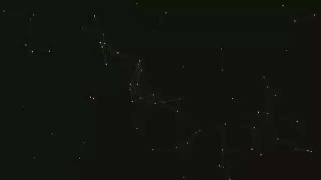

> 做一个深色极简的开场封面。标题逐字从下方浮起，带着由模糊到清晰的渐显，副标题稍后淡入。背景是缓慢漂移的粒子，相近的粒子之间连出细线，像一张慢慢呼吸的星图。整体克制安静，三秒内完成入场，之后只剩背景的微动。

#### countdown · 倒计时

> 做一个翻页牌式的倒计时。每个数字是上下两半的翻页牌，变化时上半片向下折叠，露出新的数字，折叠处有细微的阴影和厚度感。最后十秒数字变红并随秒针轻轻脉冲，归零时彩带从顶部落下，中央升起一行收尾文字。

#### kinetic-type · 动态排版

> 做预告片风格的动态排版，节奏紧凑。每一句占满整个画面，入场方式各不相同：放大冲入并抖一下，斜着滑入并拖出速度线，碎成单字后从四面八方飞来拼合，先描边再填色。每一句随节拍切换，最后所有句子叠成一张海报式的构图。

#### logo-reveal · 品牌 Logo 揭示

> 做一个品牌标志揭示动画。先用一笔画的细线勾出标志的轮廓，线条走完后颜色从内向外填满，随后一道斜向高光扫过，最后标语在下方淡入。节奏优雅，留白充足，像高端品牌的片头。

#### chapter-title · 章节转场页

> 做一个章节转场页。巨大的章节序号像里程表一样从零滚动到目标数字，标题随后从下方滑出。背景是缓慢平移的大色块、斜线或网格，层次分明。整页只有两三秒，适合放在章节之间。

#### title-split · 分屏标题入场

> 做一个分屏入场的标题页。画面被切成若干条竖带，各条依次向上滑入，拼出完整的背景图和大标题，最后竖带之间的缝隙像百叶窗合上一样淡去。

## 二、文字与排版

#### text-reveal · 逐句文案

> 做一个大字逐句出现的页面。每句换一种出场方式：打字机逐字敲出、遮罩从下向上揭开、逐词升起、故障抖动、淡入。句中的关键词用强调色标出，底部有一条细细的进度条。最后一句停在画面中央不消失。

#### quote-carousel · 金句轮播

> 做一个金句轮播。画面一侧是超大的装饰引号，正文逐字显现，署名随后从侧面滑入，每条下方有一根走完就切换的进度细线，底部圆点指示当前位置。切换时前一条淡出，后一条淡入，留白要大。

#### marquee · 滚动跑马灯

> 做一个多行无限滚动的跑马灯。每一行方向和速度不同，内容可以是大字、胶囊标签或图片卡片，首尾无缝衔接，左右两端渐隐。鼠标移到某一行上时，那一行放慢到停下。整体像一面不断流动的品牌墙。

#### particle-text · 粒子成字

> 做一个粒子成字的效果。几千个细小的光点从四处飘来，汇聚成一行大字，成字后像在呼吸一样轻轻起伏。鼠标划过时，附近的粒子被推开，鼠标离开后再缓缓回到原位。

#### credits-roll · 片尾滚动字幕

> 做一个电影片尾式的滚动字幕。黑底，职位在左、人名在右，分组之间留出大段空白，整体匀速向上滚动，顶部和底部渐隐。滚完后画面中央停下一个收尾标题。

#### danmaku · 弹幕墙

> 做一面弹幕墙。多条轨道上的文字从右向左飞过，速度略有差别，同一轨道上的文字不重叠，偶尔有一条被放大并用强调色高亮。整体像视频网站上的弹幕，热闹但不杂乱。

#### word-cloud · 词云

> 做一个词云。重要的词字号大、用强调色，次要的词小而淡。词语从中心开始沿螺旋线向外依次摆放，互不重叠，逐个淡入，最后形成一团有疏密的椭圆形。

#### matrix-rain · 字符雨

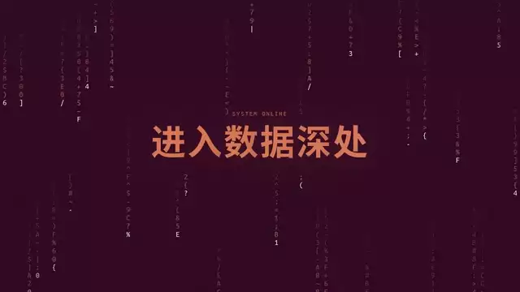

> 做一个黑客帝国式的字符雨背景。一列列字符向下落，头部最亮，尾部逐渐变暗。画面中央有一行标题逐字打出，字符雨在标题周围让开一块空地。

## 三、数据可视化

#### number-counter · 数字滚动

> 做一个大数字滚动页。几个超大的数字依次从零滚动到目标值，滚动先快后慢，数字用等宽字体所以不会左右抖动。每个数字下方有小标签，旁边可以配一根随数字一起增长的进度条。

#### chart-animated · 动态图表

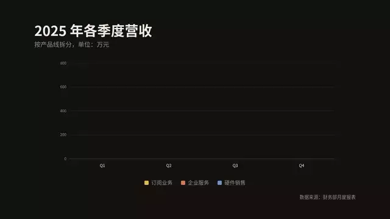

> 做一个会生长的图表页。柱状图的柱子从底线向上长出，折线沿着路径一笔画出并在下方铺一层淡淡的面积色，环形图的扇区按顺时针依次展开。图形走完后，数值和图例再淡入。多组数据依次取用主题的三个强调色。

#### bar-race · 排行榜赛跑

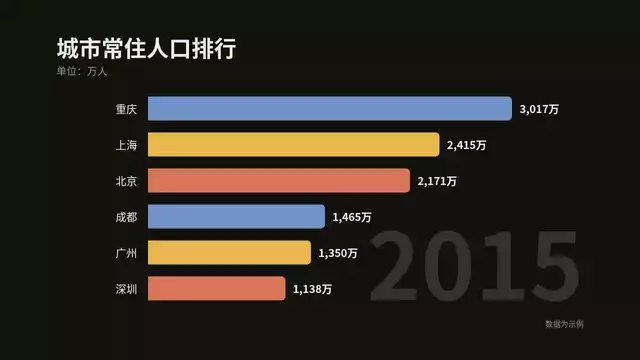

> 做一个排行榜赛跑动画。横向的条形随时间变化，排名交换时条形平滑地上下换位，每个名字始终是同一种颜色。画面角落有一个大号的年份数字随时间推进，条末尾的数值同步滚动。

#### radar-chart · 雷达图

> 做一个多系列雷达图。同心圈和轴线先淡入，每个系列的半透明多边形从中心向外生长，顶点依次弹出一个小圆点。鼠标移到某个系列上，它被高亮，其他系列压暗。

#### funnel-chart · 漏斗图

> 做一个转化漏斗图。一层层梯形从上到下依次展开，颜色从主强调色渐变到次强调色，层宽按数值缩放。每层的数字滚动到位，相邻两层之间浮出一个小标签，写着转化率。

#### gantt-schedule · 甘特图

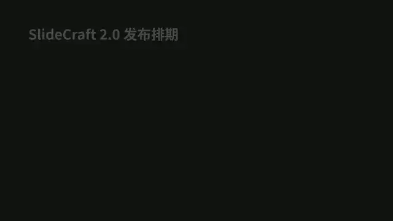

> 做一个项目甘特图。左侧是任务名和分组标题，右侧是时间轴，任务条按顺序从左向右生长，条内有一段深色表示进度，里程碑用菱形。一条"今天"竖线从左向右扫过，停在当前位置。

#### gauge-dashboard · 仪表盘

> 做一组仪表盘。每个仪表是半圆刻度盘，指针从零摆到目标值，会稍微冲过头再回弹，刻度盘分绿、黄、红三个区间。中间的数字同步滚动，下方是指标名称。

#### progress-rings · 进度环组

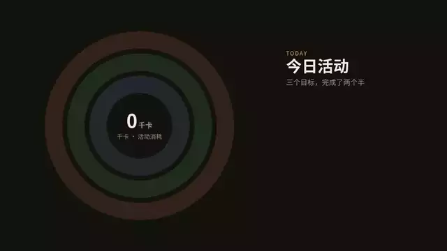

> 做一组嵌套的进度环，像运动手表的活动圆环。从最外层到最内层依次启动，每一环从十二点方向顺时针填满，端点是圆头。中央放最重要指标的大数字，超过百分之百的环会继续绕第二圈。

#### heatmap-calendar · 热力日历

> 做一个贡献图风格的热力日历。按周排成一列列，格子的颜色越深数值越高，格子从左到右一列列依次点亮。鼠标移到格子上显示日期和数值，没有数据的日子是最浅的灰。

#### sankey-flow · 桑基图

> 做一个桑基图。左右两列节点，中间是弯曲的色带表示流量，色带越宽数值越大，颜色继承自来源节点。色带沿着流向依次展开，鼠标移到一条色带上时，其他色带变暗。

#### treemap · 矩形树图

> 做一个矩形树图。大小不一的矩形铺满整个画面，面积代表数值，同一组的矩形使用同一色系的不同深浅。矩形依次缩放进场，名称和占比写在矩形里，放不下的小块自动隐藏文字。

#### stock-ticker · 行情滚动条

> 做一个行情滚动条。一行行情从右向左滚动，每项有代码、价格和涨跌幅，涨绿跌红，数值不时跳动并闪一下。下方是一条实时向右延伸的折线，像交易大屏。

## 四、流程与结构

#### timeline · 时间线

> 做一个时间线。一条细线上，事件节点按顺序依次点亮，每个节点旁边淡入时间、标题和一两行说明，已经走过的部分颜色变深。播放结束后停在最重要的那个事件上，其余节点保持可见。横向和纵向两种排法都要好看。

#### flow-diagram · 流程 / 架构图

> 做一个流程图。节点一个个弹出，随后连线像笔画一样依次描出。图搭好之后，有发光的小圆点沿着连线持续流动，表示数据在流转。重点节点用强调色，次要节点用虚线弱化。

#### step-tour · 步骤导览

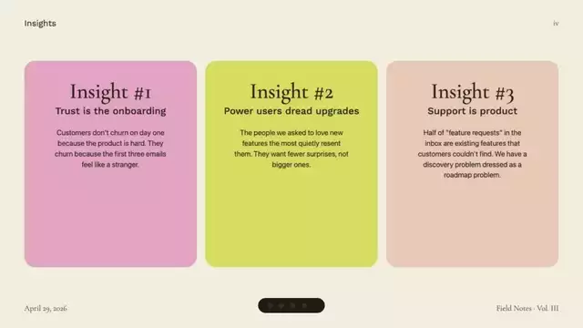

> 做一个产品导览。底图是一张界面截图，整体压暗，一束聚光灯依次移到每个要讲的区域，把那一块提亮。旁边的说明卡片自动躲开被提亮的区域，底部的圆点指示进度。

#### orbit-map · 轨道式生态图

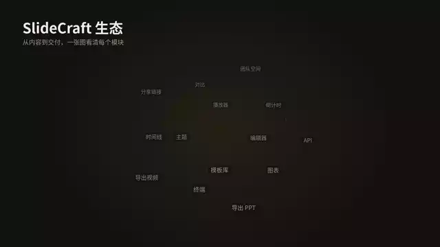

> 做一个生态图。中央是核心产品，周围是几圈同心轨道，每条轨道上均匀分布着卫星节点并缓慢旋转，文字始终保持正立。轨道略微倾斜成椭圆，带出透视感。鼠标移到卫星上，轨道暂停并弹出一张说明卡。

#### org-chart · 组织架构树

> 做一个组织架构图。人物卡片自上而下一层层展开，父子之间用圆角折线连接。点击某个节点，它下面的整棵子树收起或展开。节点很多时整张图自动缩小，始终完整地放进画面。

#### mind-map · 思维导图

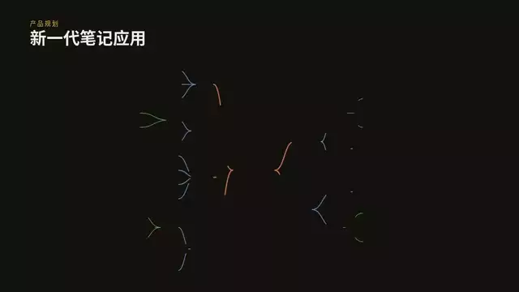

> 做一个思维导图。中心主题在画面正中，分支像树枝一样向外弯曲生长，一层层地展开，每一层换一个强调色。左右两侧的分支数量自动平衡，鼠标移到某个分支上时，其余分支淡下去。

#### roadmap · 产品路线图

> 做一个按季度排布的路线图。横向是几个季度，纵向是不同团队的泳道，每个计划是一块圆角色块，从左向右依次入场。已完成的打勾，进行中的带一段进度，未开始的用虚线描边。

#### swimlane · 泳道流程图

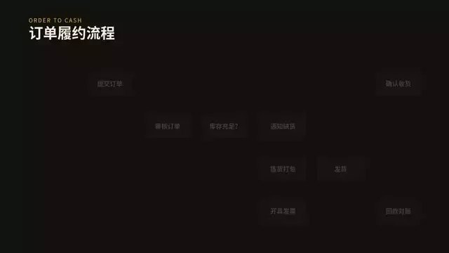

> 做一个跨角色的泳道流程图。每个角色占一条横向泳道，流程块放在各自的泳道里，箭头跨泳道连接。流程按顺序逐步点亮，一个小亮点沿着箭头走过去，指出下一步在哪。

#### decision-tree · 决策树

> 做一个决策树。从一个问题出发，每个选项分出一条枝。演示时自动沿一条路径走下去，路径上的节点依次高亮，其余分支变暗，最后给出结论。演示结束后可以手动点选，顶部的面包屑记录走过的路径。

#### swot-matrix · 四象限矩阵

> 做一个四象限矩阵。先画出十字坐标线，四个象限依次高亮并淡入各自的要点，其余象限压暗。也可以做成散点版本，每个条目按横纵位置落在对应象限里，旁边带小标签。

#### layer-stack · 分层架构图

> 做一个分层架构图。一条条圆角横带自下向上依次堆叠起来，每层里面排着若干模块小块。点击某一层，它放大到画面中央，其他层退后变淡，按 Esc 恢复。

## 五、媒体与图片

#### gallery · 图片展示墙

> 做一面图片展示墙。十几张图片错落排布，带着轻微的旋转依次飞入，静止时像挂在墙上一样微微摆动。鼠标移上去的图片会 3D 倾斜并略微抬起，点击后放大成灯箱。

#### media-wall · 媒体墙

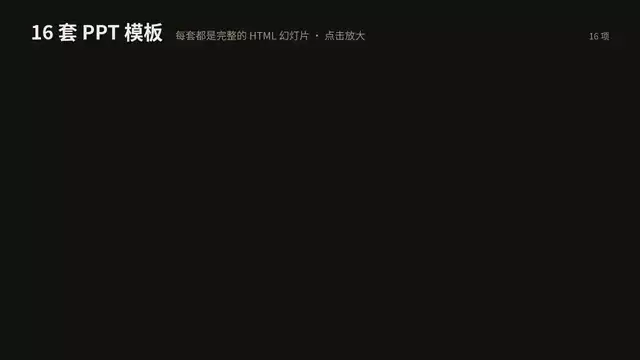

> 做一面媒体墙。图片、动图和视频拼成整齐的网格，整面墙自动缩放到刚好占满一屏，卡片从左上到右下依次入场。视频静音循环播放，鼠标移上去的卡片轻轻倾斜，点击后打开灯箱，可以用左右键翻看。

#### compare-slider · 前后对比滑块

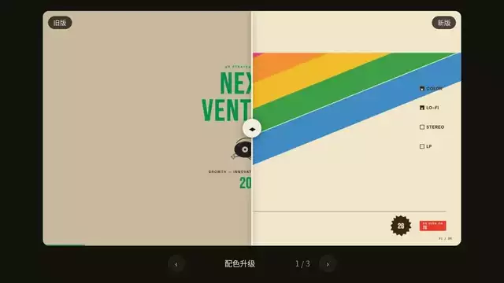

> 做一个前后对比滑块。两张图叠在一起，中间一条可以拖动的分隔线，一侧标着"前"，另一侧标着"后"。页面加载时分隔线自己从一端扫到另一端，让人看清差异，用户一碰它就交还控制权。

#### carousel-3d · 3D 图片轮播

> 做一个 3D 图片轮播。中间一张卡片又大又正，两侧的卡片向后旋转并层层叠放，下方带淡淡的倒影。也可以排成圆环，所有卡片绕着一根看不见的柱子旋转。支持拖动和方向键，当前图片的标题在下方平滑切换。

#### polaroid-scatter · 拍立得散落

> 做一个拍立得相片散落的效果。相片带着白边和手写的说明，以不同的角度一张张从画面外抛进来，落在桌面上，叠放处有轻微的阴影。点击某一张，它被拉到最上面并放大。

#### parallax-layers · 视差分层

> 做一个视差分层的场景。远山、中景、近景和标题分成多层，鼠标移动时各层按不同比例反向位移，产生纵深感。鼠标不动时，画面自己缓慢漂移，像镜头在轻轻呼吸。

#### flip-cards · 翻转卡片

> 做一组 3D 翻转卡片。入场后依次翻转一次给人看，露出背面的说明，然后翻回来。之后鼠标移上去或点击，卡片沿竖轴翻面，翻动时带高光掠过。正面是图标或短标题，背面是几行文字。

#### zoom-lens · 放大镜细节

> 做一个放大镜细节展示。一张大图上有一个圆形放大镜，自动沿着几个预设点位移动并放大局部，旁边同步出现这一处的说明。巡游结束后，用户可以自己拖动放大镜。

#### video-frame · 设备相框视频

> 做一个带设备外框的展示。笔记本、手机或电视的外框轻轻倾斜并上下浮动，屏幕里循环播放画面。外框旁边伸出几条细标注线，指向屏幕里的关键位置，末端是小圆点和一行说明。

## 六、产品与界面演示

#### chat-sim · Claude Code 对话模拟

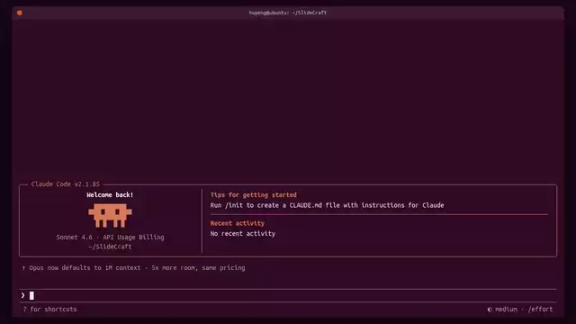

> 做一个终端风格的 AI 编程对话。深色背景，用户的问题逐字敲出，AI 的回复逐字流出。中间穿插读文件、改文件、跑命令的工具调用行，以及红绿对照的代码改动块，还原真实的使用过程。

#### terminal-demo · 终端演示

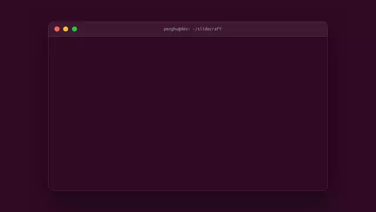

> 做一个仿 macOS 终端的演示窗口。命令逐字敲出后回车，日志一行行输出，成功和报错用不同颜色区分，中间有一根进度条走满。窗口顶部有三个圆点，结尾保留闪烁的光标。

#### browser-demo · 浏览器 / 手机演示

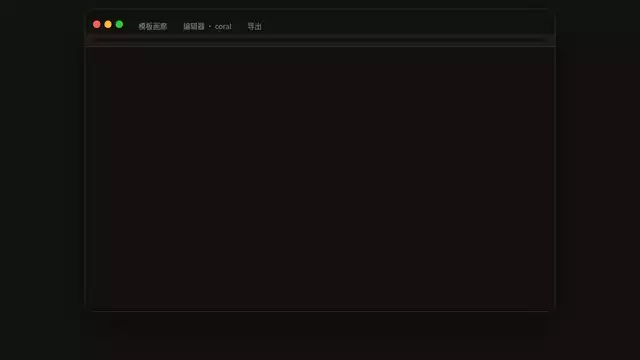

> 做一个设备窗口演示。浏览器窗口（可带标签页）或竖屏手机里依次展示几张截图，一个鼠标指针在画面上移动，到点击位置时漾开一圈波纹。切换画面时地址栏和标签同步变化，画面下方有一行说明。

#### code-showcase · 代码演示

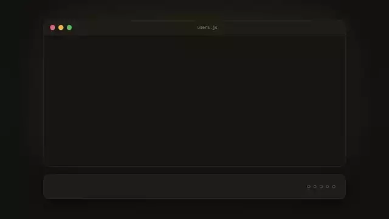

> 做一个代码演示窗口。窗口顶部有三个圆点和文件名，代码带语法高亮。同一段代码分几步演变：新增的行闪一下绿色并滑入，删除的行闪红后收起，没变的行纹丝不动。需要强调的几行保持明亮，其余压暗，下方的说明条随步骤更新。

#### phone-scroll · 手机长图滚动

> 做一个手机里滚动长页面的展示。手机外框固定不动，里面一张很长的页面截图匀速向上滚，在几个关键位置停下，旁边弹出一个批注气泡说明这一段，然后继续滚动。

#### notification-stack · 通知堆叠

> 做一个系统通知依次弹出的效果。卡片从屏幕边缘滑入，叠在一起，旧的被推到下方并缩小淡出。每张卡片有应用图标、标题、正文和时间，节奏像手机上陆续收到消息。

#### command-palette · 命令面板

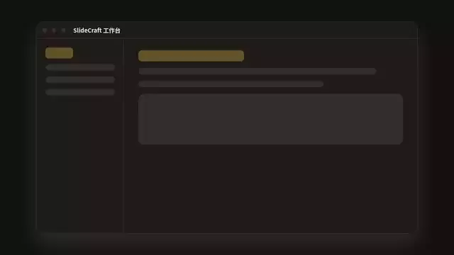

> 做一个 Cmd+K 式的命令面板演示。面板从中央弹出，输入框逐字打出关键词，下方的结果列表随输入实时过滤，匹配的字符高亮。最后选中一项，该行闪一下，右下角出现执行成功的提示。

#### chat-bubbles · 聊天气泡

> 做一个聊天界面。左右两侧的气泡依次出现，对方的消息前先有三个点跳动的"正在输入"，中间可以穿插图片、卡片和语音条。气泡圆润，时间戳淡淡地挂在旁边，整体像真实的即时通讯。

#### api-playground · 接口调试

> 做一个接口调试演示。左边是请求，有方法、地址、头部和请求体，右边是响应。自动点下"发送"后，响应的状态码和耗时数字滚动出现，响应内容逐行展开，并带 JSON 语法高亮。

#### live-dashboard · 实时监控面板

> 做一个运维监控大屏。多个图块里的折线和数字持续轻微波动，状态灯随之变化。过一会儿某个图块闪红，顶部弹出一条告警，几秒后恢复正常，整体像值班室里的大屏。

#### form-wizard · 表单向导

> 做一个多步表单的演示。顶部是步骤条，输入框里的内容自己逐字敲进去，点"下一步"时内容向左滑出、下一步滑入，最后一步提交后出现一个打勾的成功动画。

## 七、信息版式

#### bento-grid · 便当盒仪表盘

> 做一个便当盒布局的仪表盘。大小不一的磁贴拼成整齐的网格，里面有大数字、文字、图片、迷你折线和清单，其中一块用强调色整块填充。磁贴从左上到右下依次带着模糊缩放入场，数字滚动到位，鼠标移上去时磁贴轻轻上浮。

#### team-cards · 团队介绍

> 做一个团队介绍页。人物卡片依次入场，没有照片的人用名字首字加渐变底色生成头像。一束聚光灯轮流停在每个人身上，那张卡片放大并展开简介，其余卡片稍微变暗。

#### pricing-plans · 价格方案

> 做一个价格方案对比。几张卡片依次上浮，价格数字滚动到位，功能点一条条打勾。推荐方案比其他卡片更大、位置更高，边框有一圈缓慢旋转的渐变光。顶部的月付、年付开关切换时，价格数字平滑过渡。

#### faq-accordion · 问答折叠

> 做一个问答手风琴。问题列表依次入场，演示时自动逐个展开又收起，展开时答案渐显，右侧的箭头旋转。演示结束后改为点击展开，同一时间只展开一项。

#### feature-table · 功能对比表

> 做一个功能对比表。每列是一个方案，每行是一项功能，单元格里是勾、叉或简短文字。表格逐行点亮，推荐的那一列有高亮底色和顶部徽标，表头始终清晰。行数多时行高自动收紧。

#### checklist-progress · 清单进度

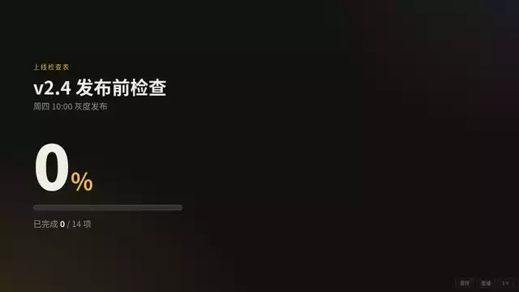

> 做一个任务清单。每项一行，依次被勾选，勾号像手写一样一笔画出，已完成的文字加上删除线并变淡。顶部的总进度条和百分比随着勾选逐步增长。

#### testimonial-wall · 评价墙

> 做一面用户评价墙。几列卡片缓慢滚动，相邻两列的方向相反，卡片里有头像、姓名、星级和一段评价。鼠标移到某一列上时，那一列停下，方便阅读。

#### stat-compare · 数字对比

> 做一个左右对比的数字页。左右各有一个超大的数字，中间一个醒目的 VS，数字从零滚动到目标值。下方一根对比条按比例分成两段，差值用箭头和百分比标在中间。

#### agenda-list · 议程目录

> 做一个议程目录页。大号的序号配标题，逐项入场，当前这一项保持明亮，其余变淡，右侧可以显示时长。整体留白很大，像杂志的目录页。

## 八、3D 与氛围

#### globe-arcs · 旋转地球飞线

> 做一个旋转的地球。球面由经纬网格和细密的点阵组成，边缘有一圈大气光晕，缓慢自转。城市位置有涟漪扩散，城市之间画出向上拱起的弧线，弧线上有一个移动的亮点。鼠标可以拖动地球，松手后继续自转。

#### tag-sphere · 3D 标签球

> 做一个 3D 标签球。一团文字标签均匀分布在球面上，整体缓慢旋转，靠近观看者的标签又大又亮，远处的又小又暗。鼠标靠近时球转得更快，并朝鼠标的方向倾斜。

#### aurora-bg · 极光背景

> 做一个极光风格的流动背景。几大块模糊的色团缓慢漂移、相互融合，颜色取自主题的三个强调色，叠一层极细的噪点颗粒。画面中央可以放一行标题，其余部分保持安静。

#### cube-rotate · 立方体翻面

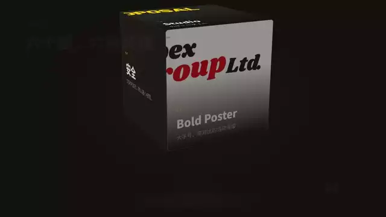

> 做一个 3D 立方体。六个面各放一幅图片或一段文字，立方体按顺序转到每一面停留片刻，旋转时带自然的透视和阴影。之后用户可以拖动它任意转动，松手后带惯性慢慢停下。

#### ripple-grid · 波纹点阵

> 做一片点阵波纹。规则排列的圆点从某一点发出圆形的波，圆点按距离依次放大、变色再恢复。点击或鼠标位置可以再发出新的波，多道波相遇时叠加。

#### terrain-lines · 山脉线条

> 做一幅线条山脉，像经典的脉冲星专辑封面。几十条横向折线逐行叠放，每条的起伏不同，前面的线遮住后面的线，整体缓缓向前流动。只用细线和背景色，克制而有力。

#### isometric-city · 等距城市

> 做一座等距视角的方块城市。高低不同的方块从地面依次升起，每个方块的顶面和两个侧面用三种明度区分，个别方块用强调色。镜头缓慢旋转或漂移，整体像一幅会生长的城市模型。

## 九、画面转场

#### iris-wipe · 圆形光圈转场

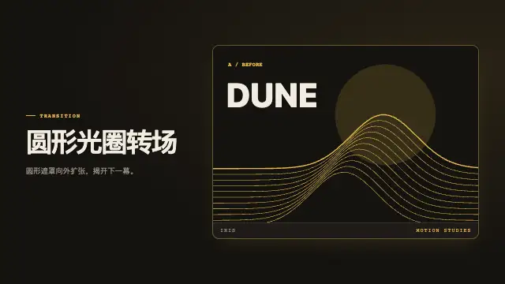

> 做一个圆形光圈转场。先展示沙丘线条，随后圆形遮罩从画面偏右处扩张，露出另一幅潮汐画面。扩张时用细色环标出边缘，最后完全切入新画面。

#### diagonal-wipe · 斜切擦除转场

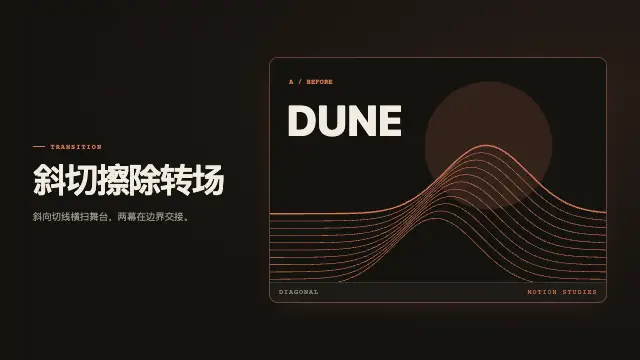

> 做一个对角线擦除转场。第二幅画面从左上方向右下方逐步覆盖第一幅画面，边界是一条细亮线，线条平稳加速后缓缓离场。

#### tile-wipe · 马赛克拼块转场

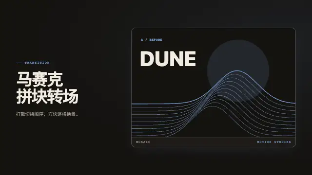

> 做一个马赛克切换效果。两幅画面严格对齐，把第二幅切成规则方格，以随机但可复现的顺序依次横向展开，像一块块替换旧画面，最后恢复为完整画面。

#### shutter-wipe · 横向百叶窗转场

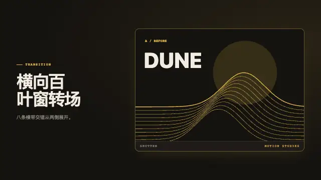

> 做一个百叶窗转场。把屏幕切成八条横带，相邻横带朝相反方向擦出新画面，加入细微延迟，直到所有横带对齐。

#### page-fold · 翻页卷角

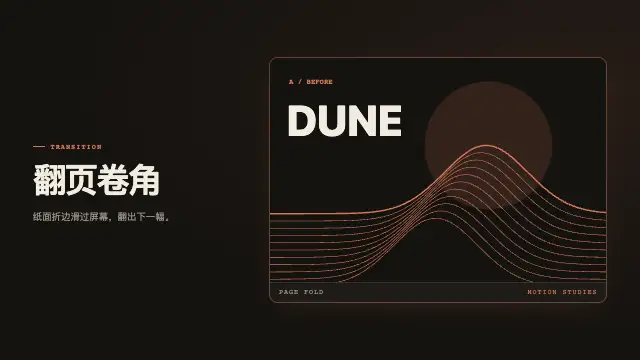

> 做一个纸张翻页效果。前一幕从右边折起，移动中的折面要有渐变和投影，纸边扫过后露出下一幅画面。

## 十、字体变形与字效

#### letter-scramble · 字符解码

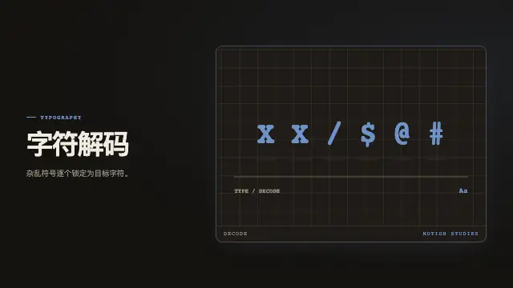

> 做一段字符解码动画。等宽槽位先以适中的频率切换符号，然后按从左到右的顺序锁定为目标单词。每锁定一格，点亮该槽位下的短线。

#### type-weight · 字重呼吸

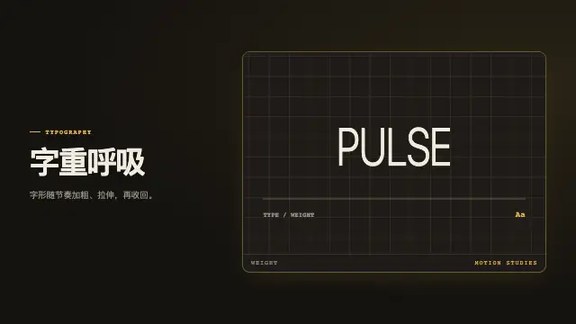

> 让一个醒目的单词像呼吸一样变化。字重从细逐渐过渡到粗，字形同步拉宽，再回到起始状态。下方短线显示这一轮呼吸的幅度。

#### type-orbit · 文字绕轨

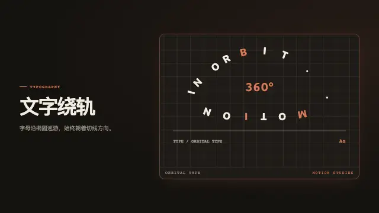

> 做一个环形文字效果。把一行文字拆成独立字符，沿椭圆均匀排列并绕中心旋转。字符朝向随切线变化，轨道轮廓轻微起伏。

#### type-echo · 描边文字回声

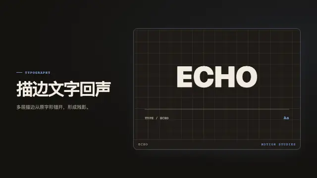

> 做一个文字回声效果。实心标题保持在前景，后方多层同形描边以不同延迟向下和向右散开。越远的描边越浅，让字形有纵深感。

#### type-underline · 手绘下划线

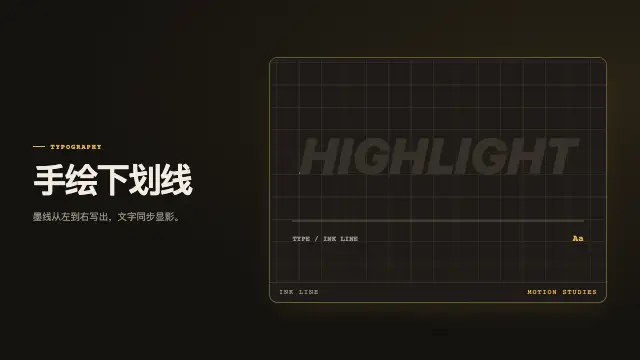

> 做一个标题标记效果。一条有轻微弧度的粗手绘线从左往右画出，墨线下方保留版式基准线，上方标题随绘制进度从浅色转为亮色。

## 十一、几何与生成图形

#### shape-morph · 几何轮廓变形

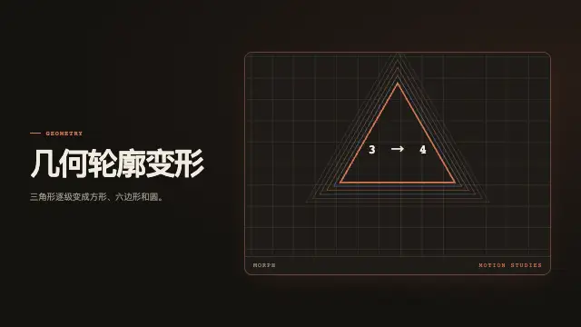

> 做一组连续变形的同心几何轮廓。在相同角度上插值各图形的半径，让三角形逐步变成四边形、六边形，最后接近圆形。中心显示当前形态。

#### harmonic-curve · 李萨如曲线

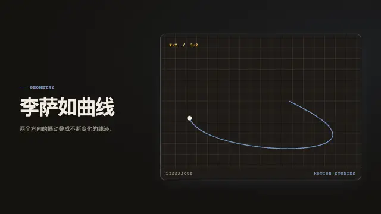

> 做一个李萨如曲线绘制器。用频率比为三比二的两个正弦振动控制横纵坐标，改变相位差，同时让亮点牵着线迹逐步画完整条曲线。

#### spirograph · 旋轮线绘图

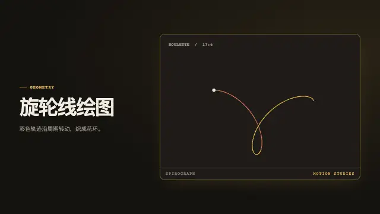

> 做一个旋轮线绘图动画。一个光点跟随两组不同速率的圆周运动，逐步拉出交叠的彩色线条，线条每隔一段换色，最终闭合成几何花环。

#### kaleidoscope · 镜像万花筒

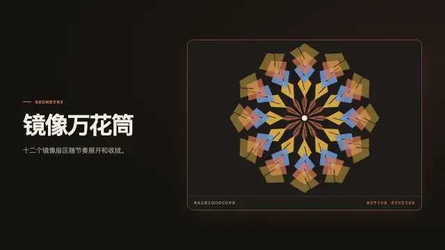

> 做一个万花筒效果。把同一组彩色菱形在十二个扇区交替镜像，始终保持放射对称。菱形沿径向依次移动并改变明暗，形成连续流动的纹样。

#### recursive-tree · 分形树生长

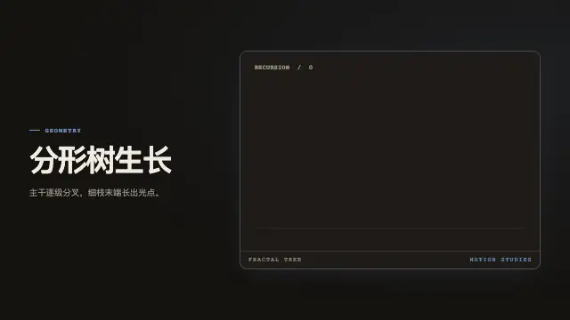

> 做一个分形树生长动画。从主干开始，每根分支长满后再分成两根更短、更细的枝条，递归多层，末梢出现小光点。让树梢随时间轻摆。

## 十二、光影与光学

#### prism-split · 三棱镜分光

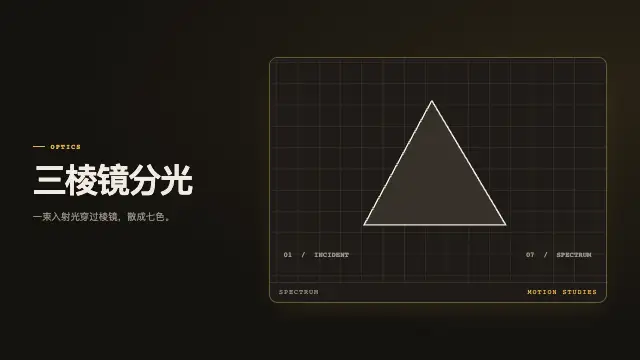

> 做一个三棱镜分光示意。细白光从左侧射入，进入三角棱镜后改变方向，在右侧出射点分成七道逐渐拉开的彩色光束。

#### light-trails · 长曝光光轨

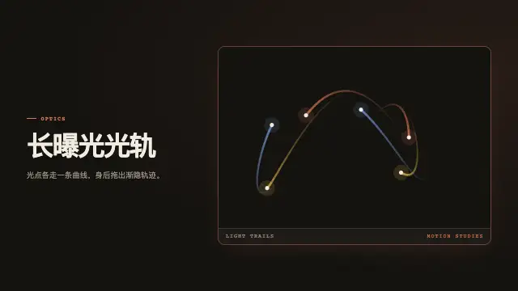

> 做一组长曝光光轨。六个发光点沿不同大小的曲线移动，轨迹近处粗亮、远处变细变暗，像相机记录下的一段段光线。

#### moire-drift · 摩尔纹干涉

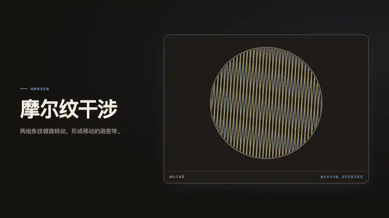

> 做一个摩尔纹动画。在圆形视窗内叠放两组间距接近的平行条纹，缓慢转动和平移其中一组，让干涉产生的宽条带随之移动。

#### holographic-sweep · 全息镭射扫光

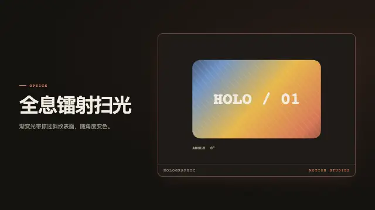

> 做一张全息材质样卡。斜纹固定在卡片表面，彩色渐变带随着模拟角度改变位置和方向，卡片下方实时显示角度。

#### chromatic-shift · 色差分离

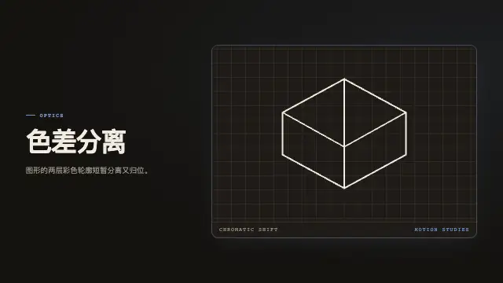

> 做一个低频色差动画。中央线框的两层彩色轮廓向左右分离，中央轮廓保持清晰，几根短扫描线在偏移时出现，随后轮廓重新对齐。

## 十三、物理与机械运动

#### spring-settle · 阻尼弹簧

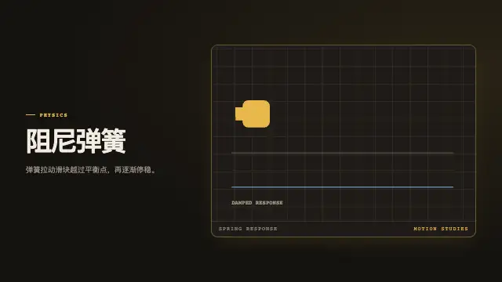

> 做一个阻尼弹簧示意。弹簧拖动色块伸出并越过目标位置，然后来回摆动，振幅逐次减小。下方同步画出位移曲线。

#### newtons-cradle · 牛顿摆

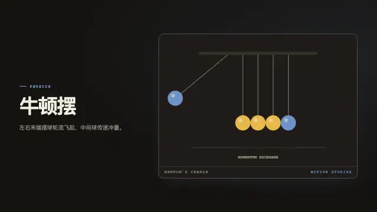

> 做一排五球牛顿摆。左端球落下碰到中间球后，右端球飞起，回落后再由左端飞起。悬线长度保持一致，球面有小高光。

#### bounce-squash · 弹跳与挤压

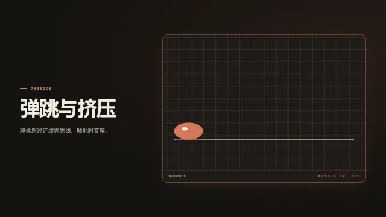

> 让一个小球沿一连串逐渐变矮的抛物线向前弹跳。触地时横向挤压，升起时恢复圆形，地面的影子随球体形状变化，背景留下运动路径。

#### domino-chain · 多米诺连锁

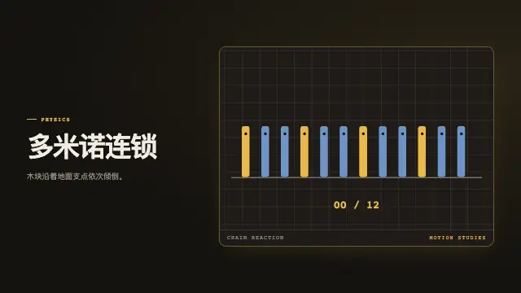

> 做一排多米诺骨牌。每块牌围绕靠近地面的支点旋转，前一块倒向下一块后触发后续倒伏，底部同步更新已经倒下的数量。

#### magnetic-field · 磁场铁屑

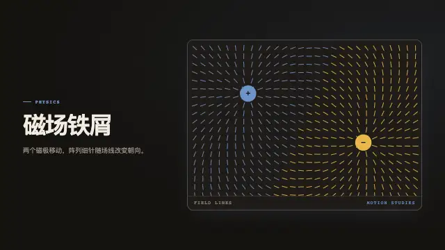

> 做一个磁场可视化。用一片短线表示各点场方向，把两个磁极沿相反方向缓慢移动，场强变化时短线平滑转动并按距离换色。

## 十四、自然与天气

#### ocean-swell · 海面涌浪

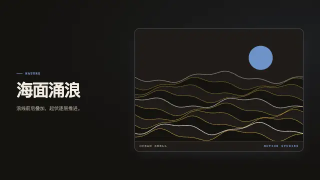

> 做一片插画式海面。用多层不同振幅和相位的波浪线组成远近水面，波峰随时间推移，远处留一轮圆日作对照。

#### rain-puddles · 雨滴落地

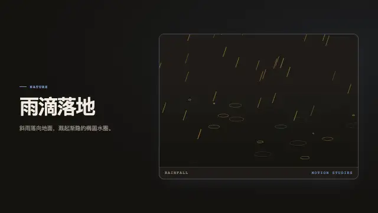

> 做一场雨。斜向细线随机从画面上方落下，到达各自的着地点后变成向外扩张的椭圆水圈。越靠近前景的水圈越显眼。

#### snow-drift · 分层飘雪

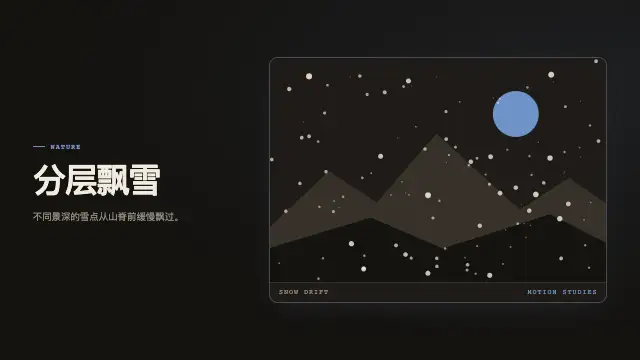

> 做一幅带两层山脊的雪夜景。用远、中、近三层雪粒营造景深，近处雪粒大、下落快，远处细小缓慢，各层都受轻微侧风影响。

#### petal-bloom · 花瓣绽放

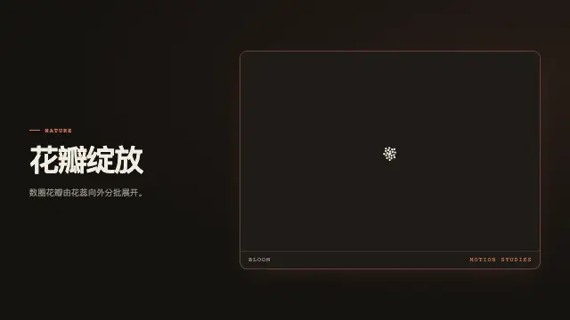

> 做一个花朵开放动画。把花瓣排成多个错开的同心轮，花瓣从花蕊处伸长并舒展，相邻层之间有短暂延迟，整朵花轻轻转动。

#### solar-eclipse · 日食与日冕

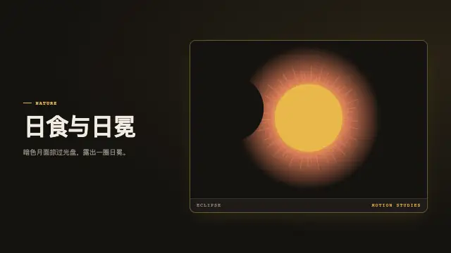

> 做一幅日食示意。深色月面横穿太阳，经过中心时短暂遮住大部分日面，只留下光环和放射状日冕，随后继续滑出。

## 十五、粒子与空间运动

#### firework-burst · 烟花爆裂

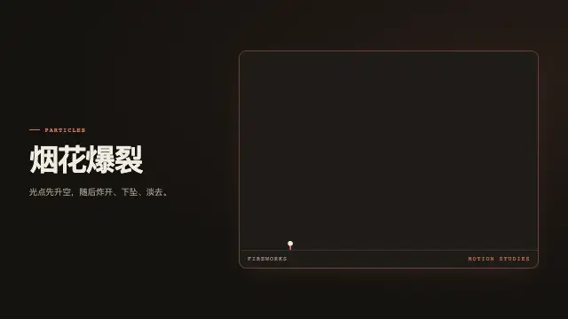

> 做几朵分时升空的烟花。每朵烟花先以一条亮迹上升，达到顶点后向四周炸开，火星沿弧线下坠并留下渐淡的尾巴。

#### particle-vortex · 粒子旋涡

> 做一个粒子旋涡。多股彩色粒子从中心出发，沿螺旋轨迹向外扩散。粒子亮度先升后降，整体始终保持旋转。

#### pixel-dissolve · 像素解体

> 做一个像素解体效果。先用小方块拼成实心菱形，再让方块按不同延迟脱离，沿斜向飞散，同时缩小、淡出。

#### star-warp · 超空间星跃

> 做一个穿越星空的效果。星点从画面中央出现，靠近边缘时加速并拉长成放射状光线，离开画面后再在远处补入新星点。

#### particle-fountain · 粒子喷泉

> 做一个粒子喷泉。颗粒从中央喷口连续喷出，按照不同的高度与侧向速度运动，达到最高处后落下，越接近落点越淡。

## 十六、指针与界面反馈

#### magnetic-cursor · 磁吸点阵

> 做一个磁吸点阵。离光标越近的圆点越向光标偏移，同时放大和换色，远处点保持原位。没有输入时用自动光标演示。

#### cursor-spotlight · 追光扫描

> 做一面暗色字符墙。圆形光束跟随指针移动，照亮附近的字符，亮度随与光心的距离自然衰减。没有输入时让光束自己巡游。

#### ink-stamp · 点击溅墨

> 做一个点击溅墨效果。在点击位置生成不规则的墨点群，让大墨滴留在近处、小墨滴飞得更远，然后一起淡出。无输入时自动示范一次。

#### spring-toggle · 弹性开关

> 做一个带弹性反馈的开关。开启和关闭时圆形滑块横向移动并轻微过冲，底色和状态文字同步更新。初始阶段自动切换几次。

#### elastic-sling · 拖拽弹力绳

> 做一个弹力绳拖拽示例。两端固定，中间的球随指针移动带动绳索拉伸。松开后球围绕原点振荡，直到恢复静止。

## 十七、动态图表进阶

#### bubble-evolution · 气泡散点演进

> 做一张气泡散点图，用位置表示两个维度，圆面积表示第三个维度。年份变化时圆连续移动和缩放，并用细线连到原始位置。

#### waterfall-bridge · 增减瀑布图

> 做一张瀑布图。从初始值开始，按顺序画出增加项和减少项，使用不同颜色并用短线连到下一项，最后显示总计柱。

#### candle-tape · K 线走时

> 做一张会逐根长出的 K 线图。每根蜡烛先长出实体，再显出上下影线。上涨与下跌使用不同颜色，横轴固定以便对比。

#### streamgraph · 流带面积图

> 做一张流带面积图。不同系列绕中心线堆叠，用连续曲线表达变化。一条竖线沿时间轴缓慢扫描，逐步露出后面的所有流带。

#### waffle-shift · 百格占比切换

> 做一张百格占比图。用十乘十的格子代表百分比，三个类别各用一种颜色。份额改变时让对应格子依次换色，旁边的百分数和格子数量保持一致。

## 十八、科技与代码

#### git-graph · Git 分支图

> 做一张会生长的 Git 分支图。主干从左向右延伸，功能分支从某个提交分叉出去，各自用不同颜色。提交点依次亮起并标出提交信息和短哈希，最后分支合并回主干，并在合并点打上版本标签。

#### neural-net · 神经网络前向传播

> 做一个神经网络前向传播的演示。几层节点从左到右排开，层间全连接，连线粗细和亮度代表权重。信号脉冲沿连线逐层流过，节点被激活时亮起，最后输出层显示各类概率，并高亮概率最高的结果。

#### packet-network · 网络数据包

> 做一张网络拓扑图，服务器、交换机和客户端用连线相连。数据包沿路径在节点间穿梭，经过节点时节点闪一下。其中一个包在途中丢失变红，随后沿原路重传成功，右上角的日志同步记录每一步。

#### code-diff · 代码 Diff

> 做一个代码审查 Diff 的动画。编辑器窗口里先显示旧版本代码，随后删除行变红并收起，新增行变绿并展开，行内具体改动的字符额外高亮。顶部的增删统计和左侧新旧行号同步变化，全部改完后底部出现审查通过的标记。

#### block-chain · 区块链

> 做一个区块链出块的演示。区块从左到右依次生成，每个区块的哈希值快速滚动计算，从左往右逐位定格，开头的若干个 0 高亮显示。出块后用链条连到上一个区块，并把上一块的哈希写进当前块的 prev 字段。

## 十九、复古与怀旧

#### crt-boot · CRT 开机

> 做一个老式 CRT 显示器开机的开场。屏幕中央先亮起一个光点，拉成一条横线，再上下展开成整幅画面。画面带扫描线、暗角、轻微闪烁和缓慢下移的亮带，荧光色的自检文字逐行打出，随后换成大标题。

#### film-leader · 老电影片头

> 做一个老电影片头倒数。圆圈里的数字从 5 倒数到 1，扇形指针绕圈扫过，背后是十字线、胶片颗粒、划痕和跳动的灰尘。倒数结束后画面切到一张带边框的标题卡。

#### neon-sign · 霓虹招牌通电

> 做一块霓虹招牌通电的画面。暗色砖墙上，灯管文字一段一段亮起，带柔和的外发光，几行文字用不同颜色。其中一个字接触不良，每隔一两秒快速闪几下再稳住。

#### vhs-glitch · 录像带故障

> 做一个录像带播放的开场。先是满屏雪花噪点，画面随后浮现出标题。之后偶发横向撕裂、红蓝色彩偏移和滚过的噪点条。左上角有播放标识，左下角是录像日期，右下角的时间码不停走动。

#### vinyl-record · 黑胶唱片

> 做一个黑胶唱片播放的画面。唱片从专辑封套里滑出并开始旋转，唱臂落下，针尖随进度缓慢内移。右侧的歌词或条目随节拍逐行高亮滚动，底部有播放进度条。

## 二十、东方与节庆

#### ink-bloom · 水墨晕染标题

> 做一个水墨晕染的标题开场。几滴墨从空中落下，在宣纸上由深到浅地向外洇开，边缘不规则、浓淡自然，还能看到纸纤维方向的细丝与飞溅的墨点。晕染中楷体大标题由模糊到清晰逐字浮现，副标题随后淡入。

#### brush-stroke · 书法逐笔书写

> 做一个书法逐笔书写的开场。宣纸上一排楷体大字按笔顺一笔一笔写出，笔画有起收与粗细变化，写完后右下角落款与小印章淡入。字与落款都可在 config 里替换。

#### scroll-unroll · 卷轴展开

> 做一个卷轴展开的开场。两根带立体感和阴影的画轴从中间向左右缓缓展开，露出卷面上的标题与几行文字条目，内容逐行淡入。

#### seal-stamp · 印章盖下

> 做一个印章盖下的开场。方形朱文印章从上方压下，轻微回弹后抬起，纸面上留下带斑驳纹理的红印，可以依次盖下多枚。

#### folding-fan · 折扇展开

> 做一个折扇展开的开场。扇骨从合拢状态依次旋开成扇形，扇面上的文字与条目随之渐次显出，最终定格成完整的扇面。
