# SlideCraft

<p align="center"><a href="https://hupengsheet.github.io/SlideCraft/site/gallery.html"></a></p>

[](https://hupengsheet.github.io/SlideCraft/site/gallery.html)

[中文](README.md)

SlideCraft is an illustrated catalog of single-page presentation effects, written in plain HTML, CSS, and JS with no build step. It groups 133 effects into 20 categories. Each one runs live in the browser and comes with an AI prompt that describes its look and motion, so you can copy the prompt to build a similar page. The [online gallery](https://hupengsheet.github.io/SlideCraft/site/gallery.html) lets you search, switch themes and speed, and change language between Chinese and English.

## Usage

- Each page is a small standalone HTML file. Edit its `config.js` to change the content; no code changes needed.
- Supports 5 themes (dark, light, paper, neon, terminal), playback speed, pause, and replay.
- Open a page directly, or embed it in a slide deck with an `<iframe>`:

```html
<iframe src="pages/number-counter/index.html?theme=light&speed=1" allow="autoplay"></iframe>
```

Embed parameters, `postMessage` control, and how to add a new page are described in [pages/README.md](pages/README.md). All prompts are collected in [PROMPTS.en.md](PROMPTS.en.md) (English) and [PROMPTS.md](PROMPTS.md) (Chinese).

## Opening & Title

<table>
<tr><td width="25%" valign="top"><a href="pages/hero-intro/">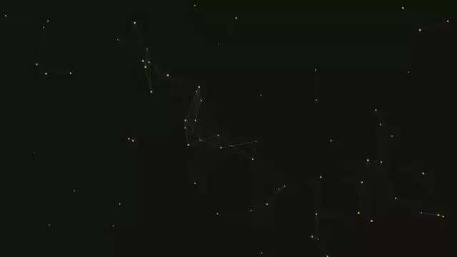</a><br><b>Opening Cover</b><br>Build a dark, minimal opening cover. The title letters float up from below, sharpening from blur into focus, and the subtitle fades in a moment later. The background is slowly drifting particles, with fine lines linking nearby particles like a star chart that slowly breathes. Keep it calm and restrained: the intro finishes in three seconds, then only subtle background motion remains.</td><td width="25%" valign="top"><a href="pages/countdown/"></a><br><b>Countdown</b><br>Build a split-flap style countdown. Each digit is a flip card with a top and bottom half; when it changes, the top half folds down to reveal the new number, with subtle shadow and thickness at the fold. In the last ten seconds the digits turn red and pulse gently with each second. When it hits zero, confetti falls from the top and a closing line rises in the center.</td><td width="25%" valign="top"><a href="pages/kinetic-type/"></a><br><b>Kinetic Typography</b><br>Build a fast, trailer-style kinetic typography sequence. Each line fills the full frame and enters in its own way: zooming in with a shake, sliding in at an angle with speed lines, breaking into single characters that fly in from all sides and reassemble, or outlining before filling with color. Lines cut on the beat, and at the end all lines stack into a poster-like composition.</td><td width="25%" valign="top"><a href="pages/logo-reveal/"></a><br><b>Brand Logo Reveal</b><br>Build a brand logo reveal. A single continuous hairline first traces the logo's outline; once the line completes, color fills the shape from the inside out. A diagonal highlight then sweeps across, and finally the tagline fades in below. The pacing is elegant with generous negative space, like a premium brand's opening title.</td></tr>
<tr><td width="25%" valign="top"><a href="pages/chapter-title/">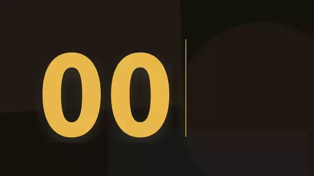</a><br><b>Chapter Divider</b><br>Build a chapter divider page. A large chapter number rolls up from zero like an odometer to its target, then the title slides up from below. The background is slowly panning color blocks, diagonal lines, or a grid, with clear layering. The whole page lasts two or three seconds and suits the space between chapters.</td><td width="25%" valign="top"><a href="pages/title-split/"></a><br><b>Split Title Entrance</b><br>Build a title page that enters in split strips. The frame is cut into vertical strips that slide up one after another, assembling the full background image and a large title. Finally, the gaps between the strips fade away like shutters closing.</td><td width="25%"></td><td width="25%"></td></tr>
</table>

## Text & Typography

<table>
<tr><td width="25%" valign="top"><a href="pages/text-reveal/"></a><br><b>Line-by-Line Text</b><br>Build a page where large text lines appear one at a time. Each line uses a different entrance: typed out character by character, revealed by a mask sweeping up, words rising one by one, a glitch shake, or a simple fade. Key words inside a line are highlighted in the accent color, with a thin progress bar at the bottom. The last line stays in the center of the frame and does not disappear.</td><td width="25%" valign="top"><a href="pages/quote-carousel/"></a><br><b>Quote Carousel</b><br>Build a quote carousel. An oversized decorative quotation mark sits on one side, the quote text appears character by character, and the attribution slides in from the side afterward. Under each quote a thin progress line fills, then switches to the next quote; dots at the bottom show the current position. Between quotes the old one fades out and the new one fades in, with generous white space.</td><td width="25%" valign="top"><a href="pages/marquee/"></a><br><b>Scrolling Marquee</b><br>Build an endlessly scrolling multi-row marquee. Each row moves in its own direction and speed, with content that can be large text, pill tags, or image cards. The loop is seamless, and both ends fade out. When the mouse hovers over a row, that row slows to a stop. The overall effect is a flowing brand wall.</td><td width="25%" valign="top"><a href="pages/particle-text/">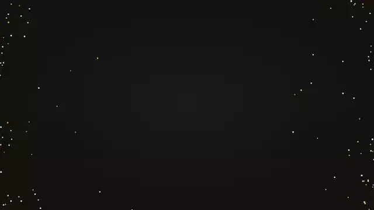</a><br><b>Particles Forming Text</b><br>Build a particle text effect. Thousands of tiny points drift in from everywhere and gather into a line of large text. Once formed, the text gently rises and falls like breathing. When the mouse moves across it, nearby particles are pushed aside, then slowly return to their places after the mouse leaves.</td></tr>
<tr><td width="25%" valign="top"><a href="pages/credits-roll/"></a><br><b>End Credits</b><br>Build a film-style end credits roll. Black background, job titles on the left and names on the right, with large gaps between groups. It scrolls up at a steady speed, fading at the top and bottom. When the roll finishes, a closing title stops in the center of the frame.</td><td width="25%" valign="top"><a href="pages/danmaku/"></a><br><b>Danmaku Wall</b><br>Build a danmaku (scrolling comment) wall. Text flies across several tracks from right to left at slightly different speeds. Text on the same track never overlaps, and now and then one item is enlarged and highlighted in the accent color. It feels like video-site comments: lively but not messy.</td><td width="25%" valign="top"><a href="pages/word-cloud/"></a><br><b>Word Cloud</b><br>Build a word cloud. Important words are large and use the accent color; minor words are small and faded. Words are placed outward from the center along a spiral without overlapping, fading in one by one, until they form an oval cluster with uneven density.</td><td width="25%" valign="top"><a href="pages/matrix-rain/"></a><br><b>Character Rain</b><br>Build a Matrix-style character rain background. Columns of characters fall downward, with the head brightest and the tail gradually dimming. A line of title text is typed out in the center, and the rain parts around the title to leave an open space.</td></tr>
</table>

## Data Visualization

<table>
<tr><td width="25%" valign="top"><a href="pages/number-counter/"></a><br><b>Number Counter</b><br>Build a big-number counter page. Several oversized numbers roll from zero to their targets one after another, starting fast and easing out. The numbers use a monospaced font so they do not jitter sideways. Each number has a small label below, and a progress bar beside it grows with the number.</td><td width="25%" valign="top"><a href="pages/chart-animated/">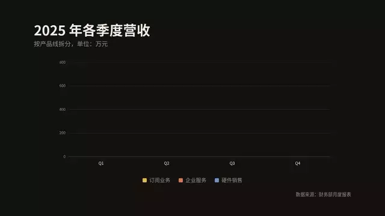</a><br><b>Animated Charts</b><br>Build a chart page where the graphics grow. Bars rise from the baseline, a line draws itself along its path with a faint area fill underneath, and donut segments expand clockwise one after another. Once the graphics finish, values and legends fade in. Multiple data series use the theme's three accent colors in order.</td><td width="25%" valign="top"><a href="pages/bar-race/">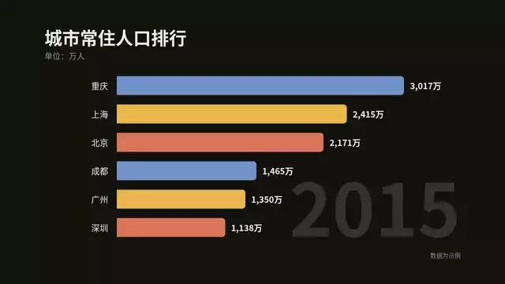</a><br><b>Bar Chart Race</b><br>Build a bar chart race. Horizontal bars change over time, and when ranks swap the bars glide up and down past each other. Each name keeps its own color throughout. A large year number in one corner advances over time, and the value at the end of each bar rolls along with it.</td><td width="25%" valign="top"><a href="pages/radar-chart/"></a><br><b>Radar Chart</b><br>Build a multi-series radar chart. Concentric rings and axes fade in first, then each series' translucent polygon grows outward from the center, with a small dot popping out at each vertex. Hovering over a series highlights it and dims the others.</td></tr>
<tr><td width="25%" valign="top"><a href="pages/funnel-chart/"></a><br><b>Funnel Chart</b><br>Build a conversion funnel. Trapezoid layers unfold from top to bottom, with colors shifting from the primary accent to the secondary accent, and each layer's width scaled to its value. The numbers roll into place on each layer, and a small label showing the conversion rate pops up between adjacent layers.</td><td width="25%" valign="top"><a href="pages/gantt-schedule/">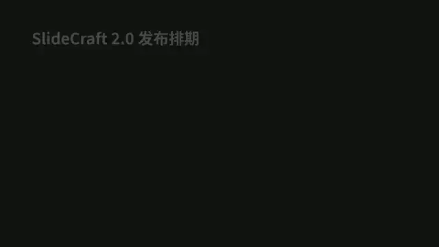</a><br><b>Gantt Chart</b><br>Build a project Gantt chart. Task names and group headers sit on the left, and a timeline runs on the right. Task bars grow from left to right in order, each with a darker segment showing progress, and milestones are diamonds. A vertical "today" line sweeps from left to right and stops at the current position.</td><td width="25%" valign="top"><a href="pages/gauge-dashboard/"></a><br><b>Gauge Dashboard</b><br>Build a set of gauge dashboards. Each gauge is a semicircular dial. The needle swings from zero to its target, overshoots slightly, then settles back. The dial is split into green, yellow, and red zones. The number in the middle rolls along with the needle, and the metric name sits below.</td><td width="25%" valign="top"><a href="pages/progress-rings/">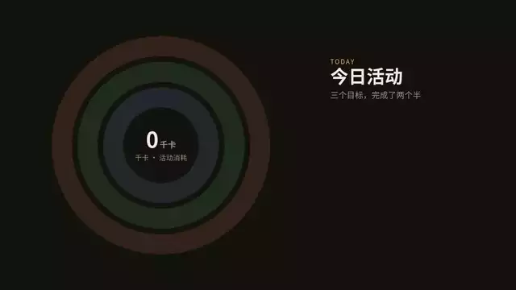</a><br><b>Progress Rings</b><br>Build a set of nested progress rings, like the activity rings on a fitness watch. They start in order from the outermost ring to the innermost, each filling clockwise from the twelve o'clock position with rounded caps. The most important metric's large number sits in the center. Rings that exceed 100% wrap around for a second lap.</td></tr>
<tr><td width="25%" valign="top"><a href="pages/heatmap-calendar/"></a><br><b>Heatmap Calendar</b><br>Build a contribution-graph style heatmap calendar. Cells are arranged in weekly columns, with darker color meaning a higher value. The columns light up from left to right. Hovering a cell shows its date and value, and days without data are the lightest gray.</td><td width="25%" valign="top"><a href="pages/sankey-flow/"></a><br><b>Sankey Diagram</b><br>Build a Sankey diagram. Nodes sit in two columns, with curved bands between them representing flow. The wider the band, the larger the value, and each band takes its color from its source node. Bands extend along their direction one after another. When the mouse is over one band, the others dim.</td><td width="25%" valign="top"><a href="pages/treemap/"></a><br><b>Treemap</b><br>Build a treemap. Rectangles of varying sizes fill the frame, with area representing value. Rectangles in the same group share a color family in different shades. They scale into place one by one, with names and percentages written inside. Labels on blocks too small to fit are hidden automatically.</td><td width="25%" valign="top"><a href="pages/stock-ticker/"></a><br><b>Stock Ticker</b><br>Build a stock ticker. A row of quotes scrolls from right to left; each item shows a symbol, price, and change percentage, with gains in green and losses in red. Values tick now and then and flash briefly. Below, a line chart keeps extending to the right, like a trading screen.</td></tr>
</table>

## Process & Structure

<table>
<tr><td width="25%" valign="top"><a href="pages/timeline/"></a><br><b>Timeline</b><br>Build a timeline. Along a thin line, event nodes light up in order. Beside each node, a time, a title, and one or two lines of description fade in, and the part already passed darkens in color. When playback ends, the view stops on the most important event while the other nodes stay visible. Both horizontal and vertical layouts should look good.</td><td width="25%" valign="top"><a href="pages/flow-diagram/"></a><br><b>Flow / Architecture Diagram</b><br>Build a flow diagram. Nodes pop out one by one, then connectors are drawn in order, as if traced by a pen. Once the diagram is complete, small glowing dots keep moving along the connectors to show data flowing through. Key nodes use the accent color, and secondary nodes use dashed outlines to recede.</td><td width="25%" valign="top"><a href="pages/step-tour/">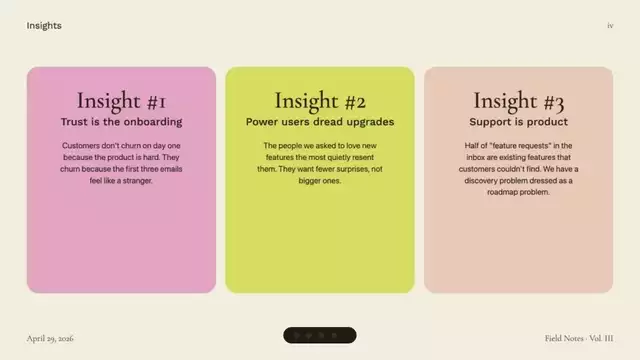</a><br><b>Step Tour</b><br>Build a product walkthrough. The base is a UI screenshot, dimmed overall. A spotlight moves to each area being explained, brightening that region. The explanation card avoids the lit area automatically, and dots at the bottom show progress.</td><td width="25%" valign="top"><a href="pages/orbit-map/">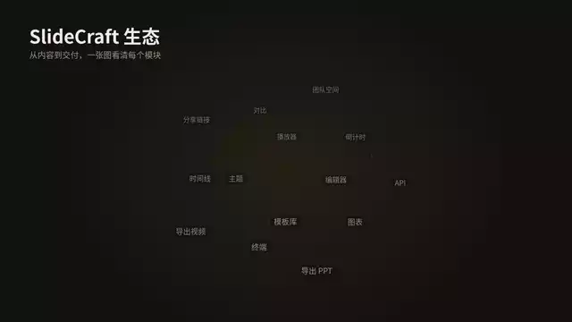</a><br><b>Orbit Ecosystem Map</b><br>Build an ecosystem map. A core product sits in the center, surrounded by several concentric orbits. Satellite nodes are spread evenly along each orbit and rotate slowly, with their labels always upright. The orbits are slightly tilted into ellipses for a sense of perspective. Hovering over a satellite pauses its orbit and shows a description card.</td></tr>
<tr><td width="25%" valign="top"><a href="pages/org-chart/"></a><br><b>Org Chart</b><br>Build an organization chart. People cards unfold level by level from top to bottom, connected by rounded elbow lines. Clicking a node collapses or expands its entire subtree. When there are many nodes, the whole chart scales down automatically so it always fits in the frame.</td><td width="25%" valign="top"><a href="pages/mind-map/">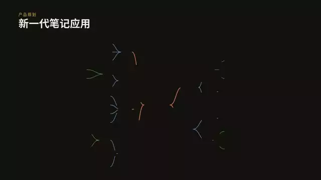</a><br><b>Mind Map</b><br>Build a mind map. The central topic sits in the middle of the frame, and branches grow outward like tree limbs, layer by layer, with a different accent color for each layer. The number of branches on the left and right balances automatically. Hovering a branch fades the others.</td><td width="25%" valign="top"><a href="pages/roadmap/"></a><br><b>Product Roadmap</b><br>Build a quarterly roadmap. Quarters run horizontally and teams run as swimlanes vertically. Each plan is a rounded colored block that enters from left to right in order. Completed items get a check mark, in-progress items show a partial progress bar, and not-started items have dashed outlines.</td><td width="25%" valign="top"><a href="pages/swimlane/">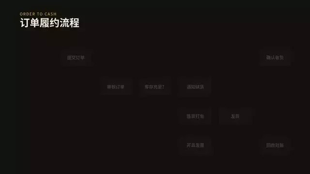</a><br><b>Swimlane Flowchart</b><br>Build a cross-functional swimlane flowchart. Each role takes one horizontal lane, process blocks sit within their own lanes, and arrows connect across lanes. The process lights up step by step, and a small glowing dot travels along the arrows to show where the next step is.</td></tr>
<tr><td width="25%" valign="top"><a href="pages/decision-tree/"></a><br><b>Decision Tree</b><br>Build a decision tree. It starts from a question, and each option branches out. In the demo, the view walks automatically down one path, nodes on that path highlight in turn, the other branches dim, and a conclusion appears at the end. After the demo, the user can click options manually, and a breadcrumb at the top records the path taken.</td><td width="25%" valign="top"><a href="pages/swot-matrix/"></a><br><b>Quadrant Matrix</b><br>Build a four-quadrant matrix. First a cross-shaped axis is drawn, then each quadrant highlights and fades in its key points in turn, with the others dimmed. There can also be a scatter version where each item lands in its quadrant by its horizontal and vertical position, with a small label beside it.</td><td width="25%" valign="top"><a href="pages/layer-stack/"></a><br><b>Layered Architecture</b><br>Build a layered architecture diagram. Rounded horizontal bands stack from bottom to top one after another, each containing several small module blocks. Clicking a layer enlarges it to the center of the frame while the others recede and fade; press Esc to restore.</td><td width="25%"></td></tr>
</table>

## Media & Images

<table>
<tr><td width="25%" valign="top"><a href="pages/gallery/"></a><br><b>Image Gallery Wall</b><br>Build an image gallery wall. Over a dozen images are scattered with a slight rotation and fly in one after another. At rest they sway gently, as if hanging on a wall. Hovering an image tilts it in 3D and lifts it slightly; clicking it enlarges it into a lightbox.</td><td width="25%" valign="top"><a href="pages/media-wall/">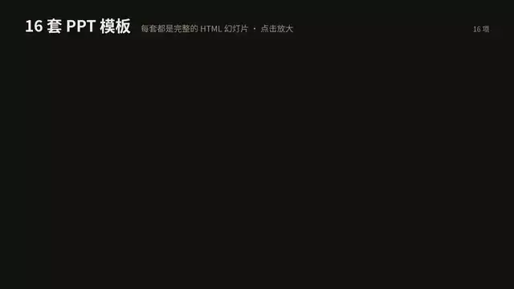</a><br><b>Media Wall</b><br>Build a media wall. Images, animated GIFs, and videos form a tidy grid, and the whole wall scales to fill one screen exactly. Cards enter from top-left to bottom-right. Videos loop muted, hovered cards tilt slightly, and clicking opens a lightbox that can be browsed with the arrow keys.</td><td width="25%" valign="top"><a href="pages/compare-slider/">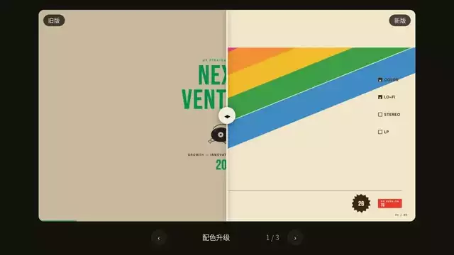</a><br><b>Before / After Slider</b><br>Build a before/after comparison slider. Two images are stacked, with a draggable divider in the middle. One side is labeled "Before" and the other "After." On page load, the divider sweeps from one end to the other on its own to show the difference, and it hands control to the user as soon as they touch it.</td><td width="25%" valign="top"><a href="pages/carousel-3d/"></a><br><b>3D Image Carousel</b><br>Build a 3D image carousel. A large, front-facing card sits in the center, while the cards on either side rotate back and stack in layers, with a faint reflection below. The layout can also form a ring, with all cards orbiting an invisible column. It supports dragging and arrow keys, and the title of the current image changes smoothly below.</td></tr>
<tr><td width="25%" valign="top"><a href="pages/polaroid-scatter/"></a><br><b>Scattered Polaroids</b><br>Build a scattered-polaroid effect. Photos with white borders and handwritten captions are tossed in from outside the frame one at a time, each at a different angle, landing on a tabletop with soft shadows where they overlap. Clicking one pulls it to the top and enlarges it.</td><td width="25%" valign="top"><a href="pages/parallax-layers/"></a><br><b>Parallax Layers</b><br>Build a parallax scene. Distant mountains, midground, foreground, and title sit on separate layers. As the mouse moves, each layer shifts at its own ratio in the opposite direction, creating depth. When the mouse is still, the scene drifts slowly on its own, like a camera gently breathing.</td><td width="25%" valign="top"><a href="pages/flip-cards/"></a><br><b>Flip Cards</b><br>Build a set of 3D flip cards. After entering, the cards flip once in turn to show their backs, which carry short descriptions, then flip back. Afterward, hovering or clicking flips a card around its vertical axis, with a highlight sweeping across during the turn. The front has an icon or short title, and the back has a few lines of text.</td><td width="25%" valign="top"><a href="pages/zoom-lens/"></a><br><b>Magnifier Detail</b><br>Build a magnifier detail view. Over a large image sits a circular magnifier that moves automatically between preset points, enlarging the area underneath, while a caption for that spot appears beside it. After the tour, the user can drag the magnifier themselves.</td></tr>
<tr><td width="25%" valign="top"><a href="pages/video-frame/"></a><br><b>Device Frame Video</b><br>Build a device-frame showcase. A laptop, phone, or TV frame tilts gently and floats up and down, with a looping video playing on its screen. Thin annotation lines reach out from the frame to point at key spots on the screen, ending in small dots with a line of explanation.</td><td width="25%"></td><td width="25%"></td><td width="25%"></td></tr>
</table>

## Product & Interface Demos

<table>
<tr><td width="25%" valign="top"><a href="pages/chat-sim/">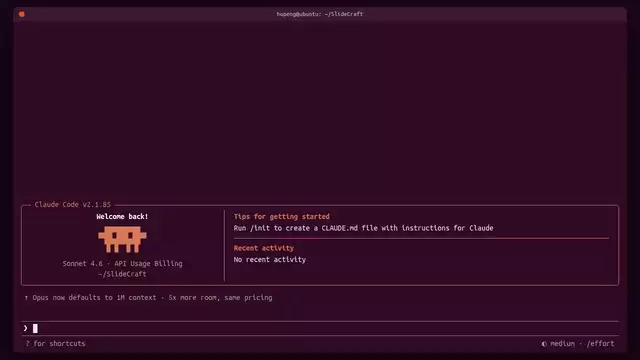</a><br><b>Claude Code Chat Simulation</b><br>Build a terminal-style AI coding conversation. On a dark background, the user's question is typed out character by character, and the AI's reply streams in word by word. Interleaved are tool-call lines for reading files, editing files, and running commands, along with red-and-green code diff blocks that recreate a real working session.</td><td width="25%" valign="top"><a href="pages/terminal-demo/">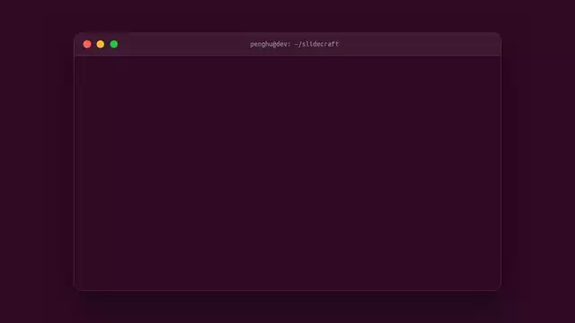</a><br><b>Terminal Demo</b><br>Build a demo window styled like the macOS Terminal. Commands are typed out character by character and submitted with Enter. Log lines print one by one, success and error messages are colored differently, and a progress bar fills to the end. Three dots sit at the top of the window, and a blinking cursor remains at the end.</td><td width="25%" valign="top"><a href="pages/browser-demo/">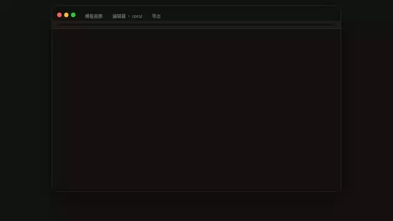</a><br><b>Browser / Phone Demo</b><br>Build a device-window demo. Several screenshots appear in turn inside a browser window (optionally with tabs) or a vertical phone screen. A mouse pointer moves across the frame, and at each click point a ripple spreads out. When the view changes, the address bar and tabs update to match, and a line of explanation sits below the frame.</td><td width="25%" valign="top"><a href="pages/code-showcase/">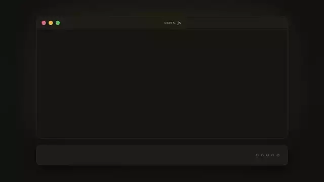</a><br><b>Code Showcase</b><br>Build a code showcase window. The top bar has three dots and a file name, and the code is syntax-highlighted. The same code evolves over several steps: new lines flash green and slide in, deleted lines flash red and collapse, and unchanged lines stay still. The few lines being emphasized stay bright while the rest dim, and a caption bar below updates with each step.</td></tr>
<tr><td width="25%" valign="top"><a href="pages/phone-scroll/"></a><br><b>Phone Long-Page Scroll</b><br>Build a phone showing a long page scrolling. The phone frame stays fixed while a very long page screenshot scrolls up at a steady pace. It pauses at a few key spots, where an annotation bubble pops up beside it explaining that section, then scrolling resumes.</td><td width="25%" valign="top"><a href="pages/notification-stack/"></a><br><b>Notification Stack</b><br>Build a system notification sequence. Cards slide in from the screen edge and stack together; older ones are pushed down, shrink, and fade out. Each card has an app icon, title, body, and timestamp, with the rhythm of messages arriving on a phone.</td><td width="25%" valign="top"><a href="pages/command-palette/">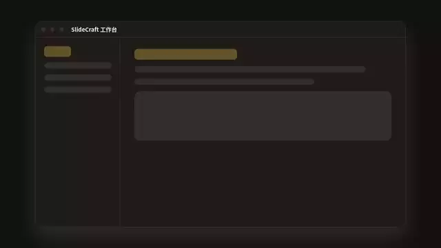</a><br><b>Command Palette</b><br>Build a Cmd+K style command palette demo. The panel pops up in the center, keywords are typed into the input field character by character, and the results list filters live beneath it, with matched characters highlighted. Finally one item is selected, its row flashes, and a success notice appears in the bottom right.</td><td width="25%" valign="top"><a href="pages/chat-bubbles/"></a><br><b>Chat Bubbles</b><br>Build a chat interface. Bubbles on the left and right appear in turn. Before the other person's message, a bouncing three-dot "typing" indicator shows, and images, cards, or voice notes can be mixed in. The bubbles are rounded, timestamps sit faintly beside them, and the overall look is that of a real messaging app.</td></tr>
<tr><td width="25%" valign="top"><a href="pages/api-playground/"></a><br><b>API Playground</b><br>Build an API testing demo. The left side shows the request, with method, URL, headers, and body; the right side shows the response. A "Send" click fires automatically, after which the status code and latency roll in, the response body expands line by line, and JSON is syntax-highlighted.</td><td width="25%" valign="top"><a href="pages/live-dashboard/"></a><br><b>Live Monitoring Dashboard</b><br>Build an operations monitoring wall. Lines and numbers in several tiles keep fluctuating slightly, with status lights changing to match. After a while one tile flashes red and an alert slides in at the top, then returns to normal after a few seconds, like a screen in an on-call room.</td><td width="25%" valign="top"><a href="pages/form-wizard/">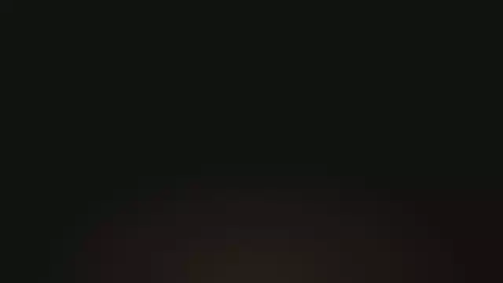</a><br><b>Form Wizard</b><br>Build a multi-step form demo. A step indicator sits at the top, and the input values type themselves in character by character. Clicking "Next" slides the content out to the left and the next step in from the right. After the final step is submitted, a check-mark success animation appears.</td><td width="25%"></td></tr>
</table>

## Information Layout

<table>
<tr><td width="25%" valign="top"><a href="pages/bento-grid/"></a><br><b>Bento Box Dashboard</b><br>Build a bento-box layout dashboard. Tiles of different sizes form a tidy grid holding big numbers, text, images, mini line charts, and checklists, with one tile filled solid in the accent color. Tiles enter from top-left to bottom-right with a blur-to-sharp scale, numbers roll into place, and a tile lifts slightly on hover.</td><td width="25%" valign="top"><a href="pages/team-cards/"></a><br><b>Team Introduction</b><br>Build a team introduction page. Profile cards enter one by one, and people without photos get generated avatars made from their name's initial on a gradient background. A spotlight takes turns resting on each person; that card enlarges to show a bio, while the others dim slightly.</td><td width="25%" valign="top"><a href="pages/pricing-plans/"></a><br><b>Pricing Plans</b><br>Build a pricing comparison. Several plan cards float up in turn, price numbers roll into place, and feature points get check marks one by one. The recommended plan is larger and sits higher, with a slowly rotating gradient glow around its border. When the monthly/yearly toggle at the top is switched, prices transition smoothly.</td><td width="25%" valign="top"><a href="pages/faq-accordion/"></a><br><b>FAQ Accordion</b><br>Build a FAQ accordion. The question list enters in turn. In the demo, items expand and collapse automatically one after another; answers fade in as they open, and the arrow on the right rotates. When the demo ends, clicking takes over, and only one item stays open at a time.</td></tr>
<tr><td width="25%" valign="top"><a href="pages/feature-table/"></a><br><b>Feature Comparison Table</b><br>Build a feature comparison table. Each column is a plan and each row is a feature, with cells showing a check, a cross, or a short phrase. The table lights up row by row, and the recommended column gets a highlighted background and a badge at the top, with the header always clearly visible. When there are many rows, the row height tightens automatically.</td><td width="25%" valign="top"><a href="pages/checklist-progress/">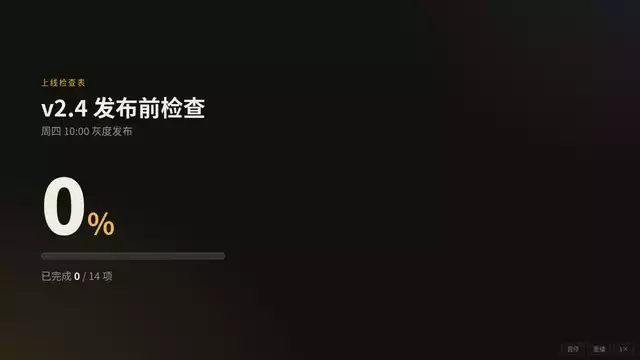</a><br><b>Checklist Progress</b><br>Build a task checklist. Each item sits on its own line and gets checked off in turn; the check mark is drawn in a single stroke, as if written by hand. Completed text gets a strikethrough and fades. The overall progress bar and percentage at the top grow as items are checked.</td><td width="25%" valign="top"><a href="pages/testimonial-wall/"></a><br><b>Testimonial Wall</b><br>Build a wall of user testimonials. Several columns of cards scroll slowly, with adjacent columns moving in opposite directions. Each card has an avatar, name, star rating, and a short quote. When the mouse hovers a column, that column stops so it can be read.</td><td width="25%" valign="top"><a href="pages/stat-compare/"></a><br><b>Number Comparison</b><br>Build a side-by-side number comparison. Oversized numbers sit on each side, with a bold "VS" in the middle, and the numbers roll from zero to their targets. Below, a comparison bar is split proportionally into two segments, and the difference is marked in the center with an arrow and a percentage.</td></tr>
<tr><td width="25%" valign="top"><a href="pages/agenda-list/"></a><br><b>Agenda Index</b><br>Build an agenda index page. Large numerals sit beside titles, entering one at a time. The current item stays bright while the rest fade, and durations can appear on the right. The generous white space makes it feel like a magazine table of contents.</td><td width="25%"></td><td width="25%"></td><td width="25%"></td></tr>
</table>

## 3D & Atmosphere

<table>
<tr><td width="25%" valign="top"><a href="pages/globe-arcs/"></a><br><b>Rotating Globe with Arcs</b><br>Build a rotating globe. The sphere is made of latitude-longitude lines and a fine dot matrix, with a ring of atmospheric glow at its edge, turning slowly. Ripples spread from city locations, and arcs rise between cities, with a bright point moving along each arc. The globe can be dragged, and after release it resumes rotating.</td><td width="25%" valign="top"><a href="pages/tag-sphere/"></a><br><b>3D Tag Sphere</b><br>Build a 3D tag sphere. A cloud of text tags is spread evenly over a sphere that rotates slowly. Tags closer to the viewer are large and bright, while distant ones are small and dim. When the mouse approaches, the sphere spins faster and tilts toward the cursor.</td><td width="25%" valign="top"><a href="pages/aurora-bg/"></a><br><b>Aurora Background</b><br>Build an aurora-style flowing background. Several large blurred color blobs drift slowly and blend into each other, using the theme's three accent colors, with a very fine grain overlay. A line of title can sit in the center, while the rest stays calm.</td><td width="25%" valign="top"><a href="pages/cube-rotate/">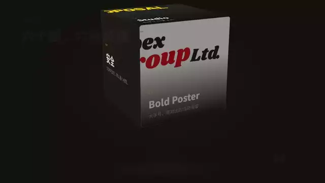</a><br><b>3D Cube Flip</b><br>Build a 3D cube. Each of its six faces holds an image or a block of text. The cube turns in sequence, pausing briefly on each face, with natural perspective and shadow during the turn. Afterward, the user can drag it to rotate freely, and after release it coasts to a stop with inertia.</td></tr>
<tr><td width="25%" valign="top"><a href="pages/ripple-grid/"></a><br><b>Ripple Dot Grid</b><br>Build a field of rippling dots. Evenly spaced dots send out circular waves from a source point; each dot scales up and changes color by its distance, then returns to normal. Clicking or moving the mouse emits new waves, and overlapping waves combine.</td><td width="25%" valign="top"><a href="pages/terrain-lines/"></a><br><b>Line Mountains</b><br>Build a line-art mountain range, in the style of the classic pulsar album cover. Dozens of horizontal polylines stack row by row, each with different undulations, with nearer lines hiding those behind. The whole stack flows slowly forward. Only thin lines and the background color are used, restrained yet striking.</td><td width="25%" valign="top"><a href="pages/isometric-city/"></a><br><b>Isometric City</b><br>Build an isometric block city. Blocks of varying height rise from the ground in turn, with each block's top and two sides in three different brightness levels, and a few blocks in the accent color. The camera turns or drifts slowly, like a city model growing before your eyes.</td><td width="25%"></td></tr>
</table>

## Screen Transitions

<table>
<tr><td width="25%" valign="top"><a href="pages/iris-wipe/">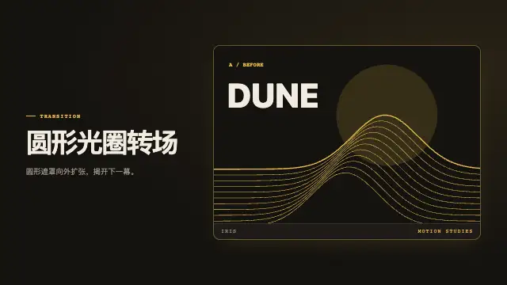</a><br><b>Iris Transition</b><br>Build a circular iris transition. First a dune-line scene is shown, then a circular mask expands from a point right of center, revealing a second, tidal scene. The edge of the expanding circle is marked with a thin colored ring, and finally the new scene fully takes over.</td><td width="25%" valign="top"><a href="pages/diagonal-wipe/">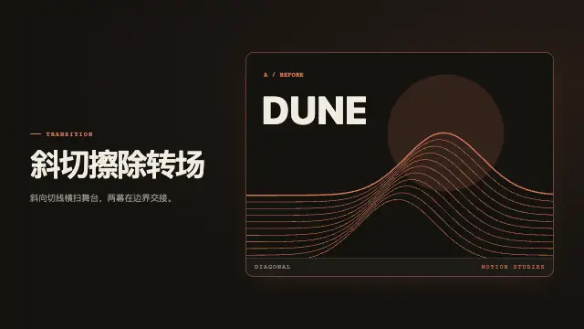</a><br><b>Diagonal Wipe</b><br>Build a diagonal wipe transition. The second image progressively covers the first from the top-left toward the bottom-right. The boundary is a thin bright line that accelerates smoothly and then eases out.</td><td width="25%" valign="top"><a href="pages/tile-wipe/">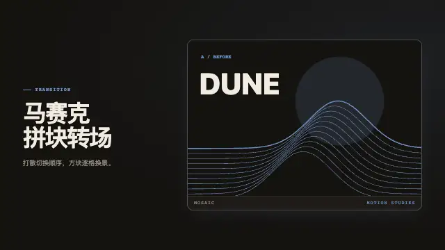</a><br><b>Mosaic Tile Transition</b><br>Build a mosaic switch effect. Two images align exactly; the second is cut into a regular grid of squares that appear in a random but repeatable order, sweeping across horizontally and replacing the old image block by block. Finally the full image is restored.</td><td width="25%" valign="top"><a href="pages/shutter-wipe/">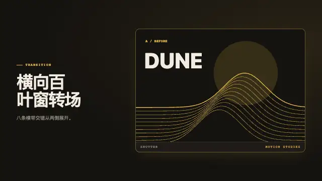</a><br><b>Horizontal Blinds Transition</b><br>Build a venetian-blind transition. The screen is cut into eight horizontal strips, and adjacent strips wipe in the new image in opposite directions with slight staggered timing until all the strips line up.</td></tr>
<tr><td width="25%" valign="top"><a href="pages/page-fold/">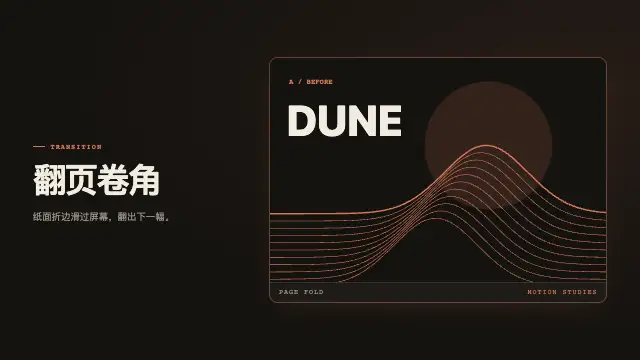</a><br><b>Page Fold</b><br>Build a paper page-turn effect. The current scene folds over from the right; the moving fold has a gradient and drop shadow, and once the paper edge sweeps across, the next scene is revealed.</td><td width="25%"></td><td width="25%"></td><td width="25%"></td></tr>
</table>

## Typography Effects

<table>
<tr><td width="25%" valign="top"><a href="pages/letter-scramble/">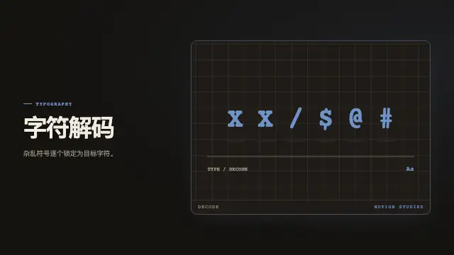</a><br><b>Character Decode</b><br>Build a character-decode animation. Fixed-width slots first cycle through random symbols at a moderate pace, then lock onto the target word from left to right. Each locked slot lights up a short underline beneath it.</td><td width="25%" valign="top"><a href="pages/type-weight/">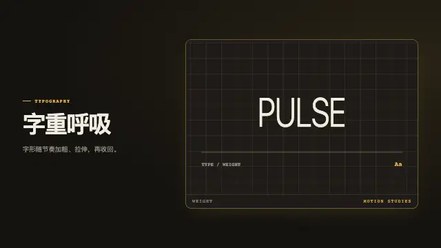</a><br><b>Breathing Type Weight</b><br>Build a bold word that breathes. Its weight shifts from thin to heavy and the letterforms widen in step, then return to the starting state. A short line below shows the amplitude of each breath.</td><td width="25%" valign="top"><a href="pages/type-orbit/">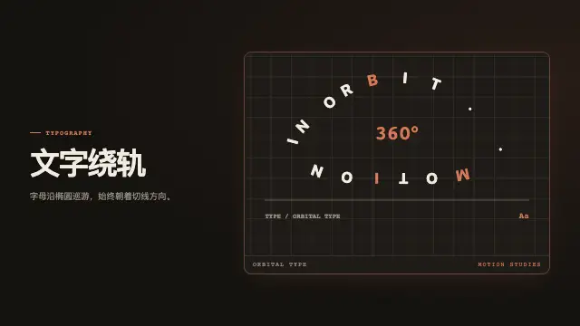</a><br><b>Text on an Orbit</b><br>Build a circular text effect. A line of text is split into individual characters, spaced evenly along an ellipse, and rotates around the center. Each character's orientation follows the tangent of the path, and the orbit outline wobbles slightly.</td><td width="25%" valign="top"><a href="pages/type-echo/">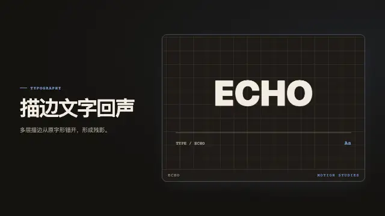</a><br><b>Outlined Text Echo</b><br>Build a text echo effect. A solid title stays in front, while several outlined copies behind it spread down and to the right with different delays. The farther copies are fainter, giving the lettering a sense of depth.</td></tr>
<tr><td width="25%" valign="top"><a href="pages/type-underline/">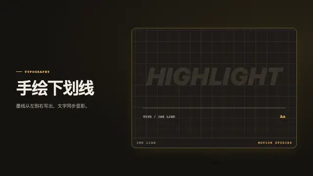</a><br><b>Hand-Drawn Underline</b><br>Build a title highlight effect. A slightly curved, thick hand-drawn stroke is drawn from left to right. A baseline stays under the ink line, and the title shifts from a light tone to a bright one as the stroke progresses.</td><td width="25%"></td><td width="25%"></td><td width="25%"></td></tr>
</table>

## Geometry & Generative Graphics

<table>
<tr><td width="25%" valign="top"><a href="pages/shape-morph/">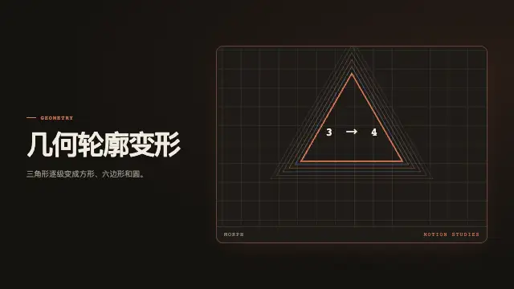</a><br><b>Geometric Outline Morph</b><br>Build a set of concentric geometric outlines that morph continuously. Radii are interpolated at the same angles, so a triangle gradually turns into a square and a hexagon, and finally approaches a circle. The current shape name is shown in the center.</td><td width="25%" valign="top"><a href="pages/harmonic-curve/">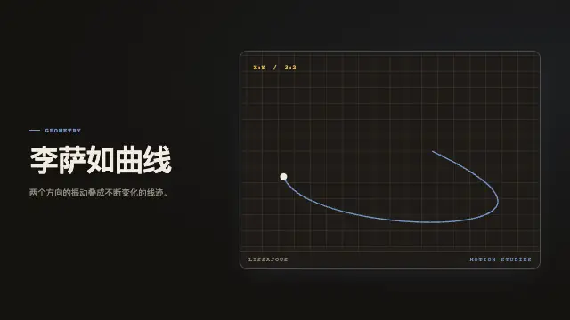</a><br><b>Lissajous Curve</b><br>Build a Lissajous curve plotter. Two sine oscillations at a three-to-two frequency ratio drive the x and y coordinates. As the phase difference changes, a bright point traces the path until the full curve is drawn.</td><td width="25%" valign="top"><a href="pages/spirograph/">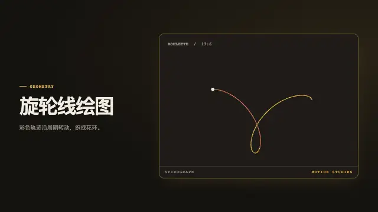</a><br><b>Spirograph</b><br>Build a spirograph animation. A point follows two circular motions at different rates, gradually drawing overlapping colored lines. The color changes every so often, and the drawing finally closes into a geometric flower wreath.</td><td width="25%" valign="top"><a href="pages/kaleidoscope/">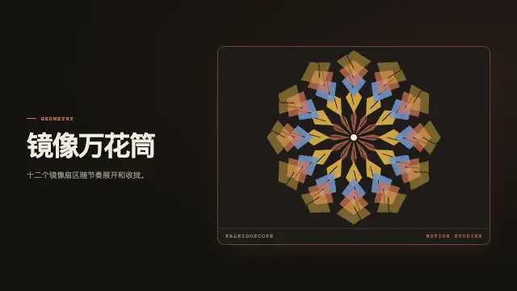</a><br><b>Mirror Kaleidoscope</b><br>Build a kaleidoscope effect. The same set of colored rhombuses is mirrored alternately across twelve sectors, always keeping radial symmetry. The rhombuses move outward along the radius and shift in brightness, forming a continuously flowing pattern.</td></tr>
<tr><td width="25%" valign="top"><a href="pages/recursive-tree/">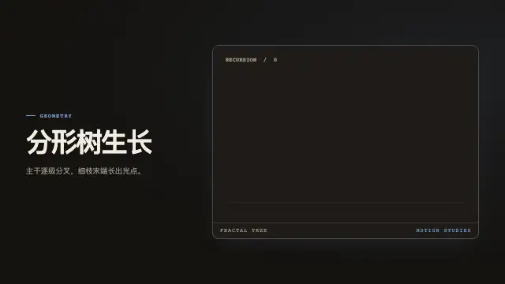</a><br><b>Fractal Tree Growth</b><br>Build a fractal tree growing animation. It starts from a trunk, and each branch, once fully grown, splits into two shorter, thinner twigs, recursing several levels, with small glowing points at the tips. The treetop sways gently over time.</td><td width="25%"></td><td width="25%"></td><td width="25%"></td></tr>
</table>

## Light & Optics

<table>
<tr><td width="25%" valign="top"><a href="pages/prism-split/">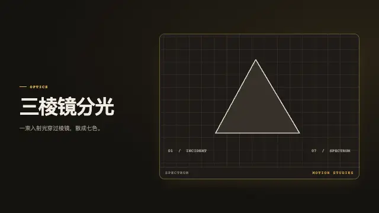</a><br><b>Prism Dispersion</b><br>Build a prism dispersion diagram. A thin white beam enters from the left, bends through a triangular prism, and leaves on the right as seven colored beams that gradually spread apart.</td><td width="25%" valign="top"><a href="pages/light-trails/">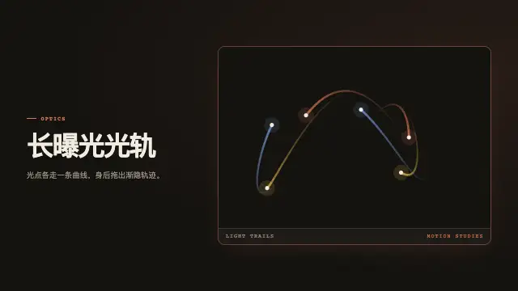</a><br><b>Long-Exposure Light Trails</b><br>Build a set of long-exposure light trails. Six glowing points move along curves of different sizes; the trails are thick and bright near the points and thin and dim farther away, like light recorded by a camera's long exposure.</td><td width="25%" valign="top"><a href="pages/moire-drift/">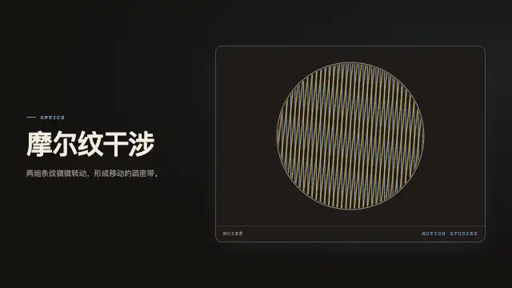</a><br><b>Moiré Interference</b><br>Build a moiré animation. Inside a circular window, two sets of parallel stripes with nearly equal spacing overlap. One set slowly rotates and shifts, moving the broad interference bands along with it.</td><td width="25%" valign="top"><a href="pages/holographic-sweep/">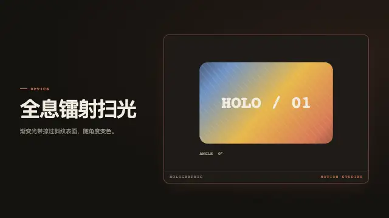</a><br><b>Holographic Foil Sweep</b><br>Build a holographic foil card. Diagonal grooves stay fixed on the card surface, while a colored gradient band changes position and direction with the simulated viewing angle. The angle is shown live below the card.</td></tr>
<tr><td width="25%" valign="top"><a href="pages/chromatic-shift/">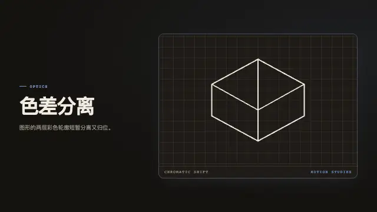</a><br><b>Chromatic Aberration</b><br>Build a low-frequency chromatic aberration animation. Two colored outlines of a central wireframe split apart to the left and right, while the center outline stays sharp. A few short scan lines appear during the offset, and then the outlines realign.</td><td width="25%"></td><td width="25%"></td><td width="25%"></td></tr>
</table>

## Physics & Mechanical Motion

<table>
<tr><td width="25%" valign="top"><a href="pages/spring-settle/">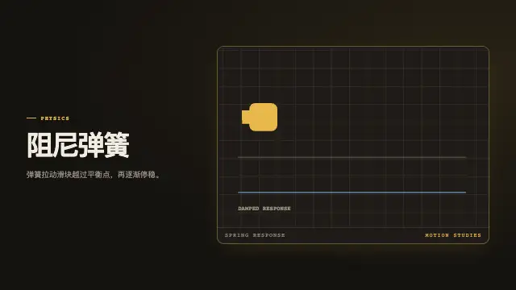</a><br><b>Damped Spring</b><br>Build a damped spring demo. A spring drags a color block out past its target, then it swings back and forth with decreasing amplitude. A displacement curve is drawn below in sync.</td><td width="25%" valign="top"><a href="pages/newtons-cradle/">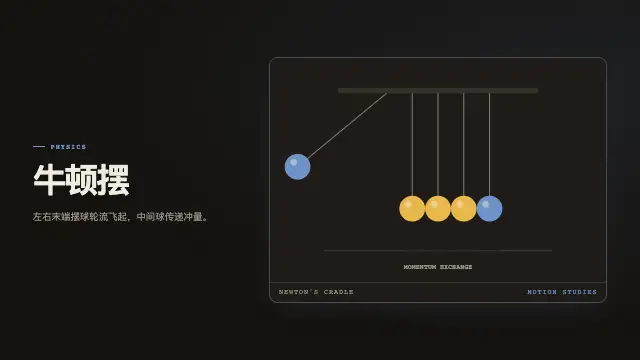</a><br><b>Newton's Cradle</b><br>Build a five-ball Newton's cradle. The ball on the left falls and strikes the middle ball, and the ball on the right swings out; after it returns, the ball on the left swings out. The string lengths stay consistent, and the spheres have small highlights.</td><td width="25%" valign="top"><a href="pages/bounce-squash/">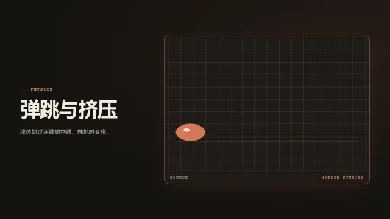</a><br><b>Bounce and Squash</b><br>Build a ball bouncing forward along a series of parabolas that get progressively lower. It squashes sideways on landing and returns to round as it rises, and its ground shadow changes shape with the ball. The background keeps the motion path.</td><td width="25%" valign="top"><a href="pages/domino-chain/">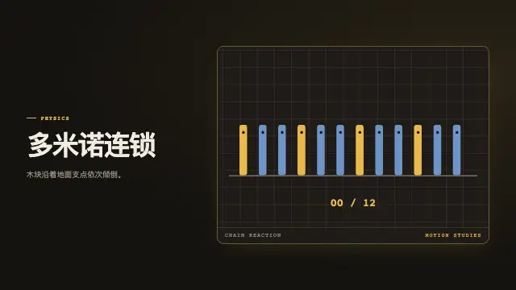</a><br><b>Domino Chain Reaction</b><br>Build a row of dominoes. Each tile rotates around a pivot near the ground; when one falls against the next, it triggers the following tiles to topple. A counter at the bottom updates the number of fallen tiles.</td></tr>
<tr><td width="25%" valign="top"><a href="pages/magnetic-field/">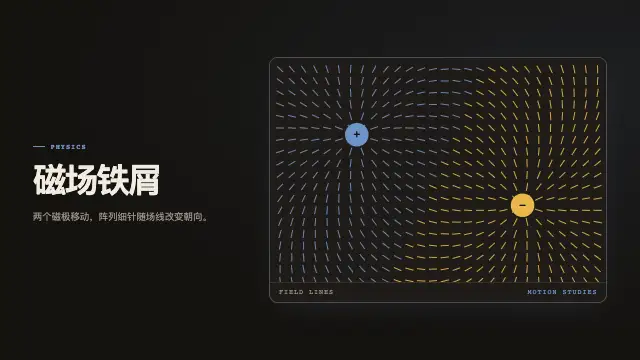</a><br><b>Magnetic Field Lines</b><br>Build a magnetic field visualization. A field of short line segments shows the direction at each point. Two magnetic poles slowly move in opposite directions, and as the field strength changes, the segments rotate smoothly and shift color with distance.</td><td width="25%"></td><td width="25%"></td><td width="25%"></td></tr>
</table>

## Nature & Weather

<table>
<tr><td width="25%" valign="top"><a href="pages/ocean-swell/">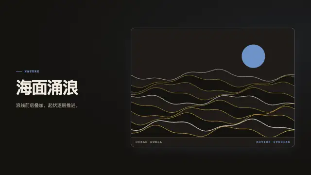</a><br><b>Ocean Swell</b><br>Build an illustrated sea surface. Several layers of wave lines with different amplitudes and phases form near and far water, with the crests moving over time. A round sun sits on the distant horizon for contrast.</td><td width="25%" valign="top"><a href="pages/rain-puddles/">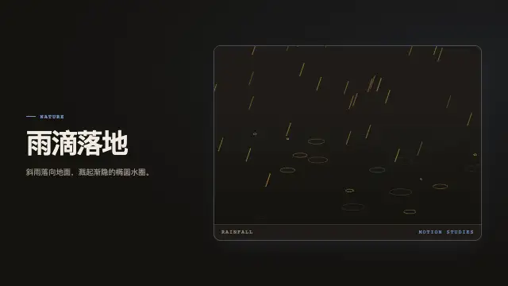</a><br><b>Rain on the Ground</b><br>Build a rainfall scene. Diagonal fine lines fall at random from the top of the frame, and on reaching their landing points they turn into expanding elliptical ripples. Ripples closer to the foreground stand out more.</td><td width="25%" valign="top"><a href="pages/snow-drift/">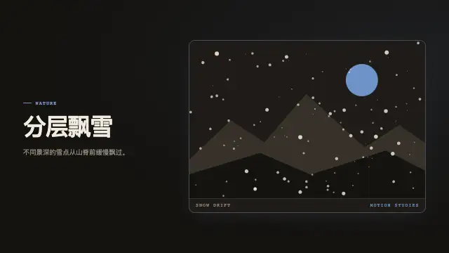</a><br><b>Layered Snowfall</b><br>Build a snowy night scene with two layers of ridges. Snowflakes in three depth layers create a sense of distance: near flakes are large and fall fast, distant ones are tiny and slow, and every layer is nudged by a light crosswind.</td><td width="25%" valign="top"><a href="pages/petal-bloom/">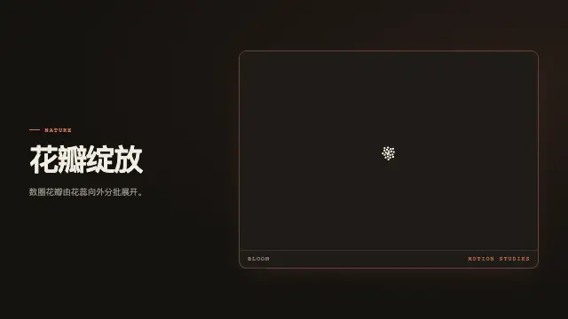</a><br><b>Petal Bloom</b><br>Build a flower-blooming animation. Petals are arranged in several staggered concentric rings, stretching outward from the center and unfolding, with a short delay between rings, while the whole flower turns slightly.</td></tr>
<tr><td width="25%" valign="top"><a href="pages/solar-eclipse/"></a><br><b>Solar Eclipse</b><br>Build a solar eclipse diagram. A dark moon crosses the face of the sun; at the center it briefly covers most of the disc, leaving only a ring of light and radiating corona, then slides on past.</td><td width="25%"></td><td width="25%"></td><td width="25%"></td></tr>
</table>

## Particles & Space Motion

<table>
<tr><td width="25%" valign="top"><a href="pages/firework-burst/"></a><br><b>Firework Bursts</b><br>Build several fireworks launched at staggered times. Each one rises as a bright trail, then bursts outward at its apex. Sparks fall along arcs and leave fading tails.</td><td width="25%" valign="top"><a href="pages/particle-vortex/"></a><br><b>Particle Vortex</b><br>Build a particle vortex. Several streams of colored particles leave the center and spread outward along spiral paths. Particle brightness rises and then falls, and the whole swirl keeps turning.</td><td width="25%" valign="top"><a href="pages/pixel-dissolve/"></a><br><b>Pixel Dissolve</b><br>Build a pixel dissolve effect. First small squares assemble into a solid diamond, then the squares break away with different delays, scatter diagonally, and shrink and fade out as they go.</td><td width="25%" valign="top"><a href="pages/star-warp/"></a><br><b>Hyperspace Star Warp</b><br>Build a starfield warp effect. Stars appear from the center of the frame, accelerate as they approach the edges, and stretch into radial light streaks. Once a star leaves the frame, a new one is added farther away.</td></tr>
<tr><td width="25%" valign="top"><a href="pages/particle-fountain/"></a><br><b>Particle Fountain</b><br>Build a particle fountain. Grains spray continuously from a central nozzle with varying heights and sideways speeds, reach their peak, and fall back, fading as they near the landing spots.</td><td width="25%"></td><td width="25%"></td><td width="25%"></td></tr>
</table>

## Pointer & Interface Feedback

<table>
<tr><td width="25%" valign="top"><a href="pages/magnetic-cursor/"></a><br><b>Magnetic Dot Grid</b><br>Build a magnetic dot grid. Dots closer to the cursor shift toward it while growing and changing color, and distant dots stay in place. Without input, an automatic cursor runs the demo.</td><td width="25%" valign="top"><a href="pages/cursor-spotlight/"></a><br><b>Spotlight Scan</b><br>Build a dark wall of characters. A circular beam follows the pointer and lights up the characters nearby, with brightness falling off naturally with distance from the beam's center. Without input, the beam wanders on its own.</td><td width="25%" valign="top"><a href="pages/ink-stamp/"></a><br><b>Ink Splash on Click</b><br>Build an ink splash effect. Each click spawns an irregular cluster of ink drops: larger drops stay close to the click point while smaller ones fly farther, then all fade out together. Without input, it demonstrates once automatically.</td><td width="25%" valign="top"><a href="pages/spring-toggle/"></a><br><b>Springy Toggle</b><br>Build a switch with spring feedback. When turned on or off, the round knob slides sideways and overshoots slightly, while the background color and status text update in sync. It toggles automatically a few times at the start.</td></tr>
<tr><td width="25%" valign="top"><a href="pages/elastic-sling/"></a><br><b>Elastic Drag Band</b><br>Build an elastic-band drag example. Both ends are fixed, and a ball in the middle follows the pointer, stretching the cord. When released, the ball oscillates around its origin until it comes to rest.</td><td width="25%"></td><td width="25%"></td><td width="25%"></td></tr>
</table>

## Advanced Chart Motion

<table>
<tr><td width="25%" valign="top"><a href="pages/bubble-evolution/"></a><br><b>Bubble Scatter Evolution</b><br>Build a bubble scatter chart where position encodes two dimensions and circle area encodes a third. As the years change, the circles move and resize continuously, with thin lines connecting them back to their original positions.</td><td width="25%" valign="top"><a href="pages/waterfall-bridge/"></a><br><b>Waterfall Chart</b><br>Build a waterfall chart. Starting from an initial value, increases and decreases are drawn in order in different colors, with short connectors linking each item to the next, and a total bar appears at the end.</td><td width="25%" valign="top"><a href="pages/candle-tape/"></a><br><b>Candlestick Tape</b><br>Build a candlestick chart that grows one candle at a time. Each candle's body extends first, then its upper and lower wicks appear. Rising and falling candles use different colors, and the time axis stays fixed for easy comparison.</td><td width="25%" valign="top"><a href="pages/streamgraph/"></a><br><b>Streamgraph</b><br>Build a streamgraph. Series stack around a central axis, with smooth curves expressing change over time. A vertical line slowly scans along the time axis, gradually revealing all the streams behind it.</td></tr>
<tr><td width="25%" valign="top"><a href="pages/waffle-shift/"></a><br><b>Waffle Chart Shift</b><br>Build a waffle chart. A ten-by-ten grid of squares represents percentages, with three categories each in its own color. When the shares change, the corresponding squares recolor one by one, and the percentage beside the grid matches the number of squares.</td><td width="25%"></td><td width="25%"></td><td width="25%"></td></tr>
</table>

## Tech & Code

<table>
<tr><td width="25%" valign="top"><a href="pages/git-graph/"></a><br><b>Git Branch Graph</b><br>Build a growing Git branch graph. The main line extends from left to right, feature branches fork from specific commits in their own colors, and commit dots light up one by one with their messages and short hashes. Finally the branch merges back into the main line, and a version tag is placed at the merge point.</td><td width="25%" valign="top"><a href="pages/neural-net/"></a><br><b>Neural Network Forward Pass</b><br>Build a neural network forward-pass demo. Layers of nodes run from left to right, fully connected between layers, with line thickness and brightness representing weights. Signal pulses travel layer by layer along the connections, lighting up activated nodes. At the end, the output layer shows class probabilities and highlights the most likely result.</td><td width="25%" valign="top"><a href="pages/packet-network/"></a><br><b>Network Packets</b><br>Build a network topology diagram with servers, switches, and clients linked by connectors. Data packets travel along paths between nodes, and each node flashes as a packet passes. One packet is lost mid-route and turns red, then is successfully resent along the same path, while a log in the top right records each step.</td><td width="25%" valign="top"><a href="pages/code-diff/"></a><br><b>Code Diff</b><br>Build an animated code review diff. The editor window first shows the old version of the code; deleted lines turn red and collapse, and added lines turn green and expand, with the specific changed characters highlighted within each line. The change counts at the top and the old and new line numbers on the left update in sync, and once every change is applied, an approved badge appears at the bottom.</td></tr>
<tr><td width="25%" valign="top"><a href="pages/block-chain/"></a><br><b>Blockchain</b><br>Build a blockchain block-mining demo. Blocks are generated from left to right; each block's hash rapidly rolls through values and locks in digit by digit from left to right, with the leading zeros highlighted. Once mined, a chain link connects it to the previous block, and the previous block's hash is written into the current block's prev field.</td><td width="25%"></td><td width="25%"></td><td width="25%"></td></tr>
</table>

## Retro & Nostalgia

<table>
<tr><td width="25%" valign="top"><a href="pages/crt-boot/"></a><br><b>CRT Power-On</b><br>Build an opening for an old CRT monitor powering on. A single point of light appears in the center of the screen and stretches into a horizontal line, then opens up vertically into the full picture. The picture carries scan lines, vignetting, slight flicker, and a slow rolling bright band. Phosphor-colored self-test text prints line by line, then gives way to a large title.</td><td width="25%" valign="top"><a href="pages/film-leader/"></a><br><b>Vintage Film Leader</b><br>Build a vintage film leader countdown. Inside a circle, numbers count down from 5 to 1; a wedge-shaped pointer sweeps around the circle on each beat. Behind it are crosshairs, film grain, scratches, and flickering dust. When the countdown ends, the picture cuts to a title card with a border.</td><td width="25%" valign="top"><a href="pages/neon-sign/"></a><br><b>Neon Sign Turn-On</b><br>Build a neon sign powering on against a dark brick wall. Tubes light up the text one segment at a time, with a soft outer glow, and each line uses a different color. One letter has a loose connection and flickers a few times every one or two seconds before steadying.</td><td width="25%" valign="top"><a href="pages/vhs-glitch/"></a><br><b>VHS Glitch</b><br>Build an opening in the style of a VHS playback. It begins with a full screen of snowy static, then the picture emerges and the title appears. Afterward, occasional horizontal tearing, red-and-blue color shifts, and rolling noise bands occur. A play indicator sits in the top left, the recording date in the bottom left, and a timecode keeps running in the bottom right.</td></tr>
<tr><td width="25%" valign="top"><a href="pages/vinyl-record/"></a><br><b>Vinyl Record</b><br>Build a vinyl record playback scene. The record slides out of its album sleeve and starts spinning, then the tonearm lowers and the needle moves slowly inward as the track progresses. On the right, lyrics or items highlight and scroll line by line with the beat, and a playback progress bar sits at the bottom.</td><td width="25%"></td><td width="25%"></td><td width="25%"></td></tr>
</table>

## Eastern & Festive

<table>
<tr><td width="25%" valign="top"><a href="pages/ink-bloom/"></a><br><b>Ink Wash Title</b><br>Build an ink-wash title opening. Several drops of ink fall from above and bloom outward across rice paper, fading from dark to light, with irregular edges and natural tonal variation. You can see fine fibers and flying ink specks. As the ink spreads, a large regular-script title materializes letter by letter from blur to sharpness, and a subtitle fades in afterward.</td><td width="25%" valign="top"><a href="pages/brush-stroke/"></a><br><b>Calligraphy Stroke by Stroke</b><br>Build a calligraphy opening where a row of large regular-script characters is written stroke by stroke in proper order on rice paper. Each stroke has a brush-like start, end, and variation in thickness. Once the characters are written, a signature and a small seal fade in at the bottom right. The characters and signature can be replaced in the config.</td><td width="25%" valign="top"><a href="pages/scroll-unroll/"></a><br><b>Scroll Unroll</b><br>Build a hand-scroll opening. Two scroll rollers with a sense of depth and shadow slowly unroll outward from the center, revealing a title and several lines of text on the scroll, with the content fading in line by line.</td><td width="25%" valign="top"><a href="pages/seal-stamp/"></a><br><b>Seal Stamp</b><br>Build a seal-stamping opening. A square vermilion seal presses down from above, rebounds slightly, and lifts away, leaving a red impression with a mottled texture on the paper. Multiple seals can be stamped one after another.</td></tr>
<tr><td width="25%" valign="top"><a href="pages/folding-fan/"></a><br><b>Folding Fan Unfurl</b><br>Build a folding-fan opening. The closed fan ribs open one by one into a fan shape, and the text and items on the fan surface gradually appear as it spreads, settling into the complete fan.</td><td width="25%"></td><td width="25%"></td><td width="25%"></td></tr>
</table>

## Tools

- [scripts/make-previews.py](scripts/make-previews.py): records each page as an animated image into `previews/` with Playwright. Requires Playwright and ffmpeg.
- [scripts/make-posters.py](scripts/make-posters.py): picks a frame from each animation and writes the static posters used by the gallery.
- [scripts/build-docs.py](scripts/build-docs.py): generates this file, the Chinese README, and the gallery data from [PROMPTS.md](PROMPTS.md) and [PROMPTS.en.md](PROMPTS.en.md).
