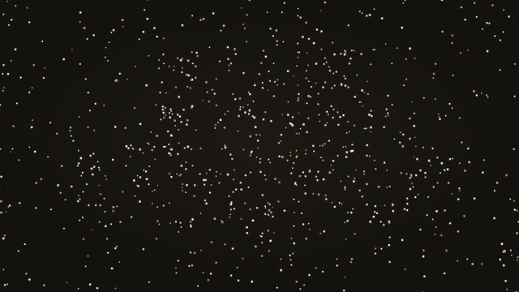
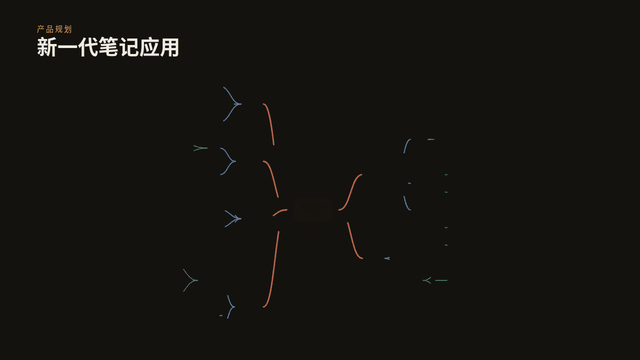
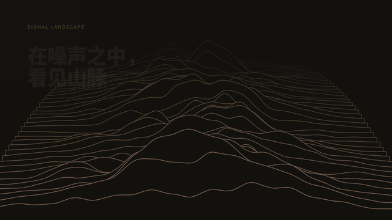
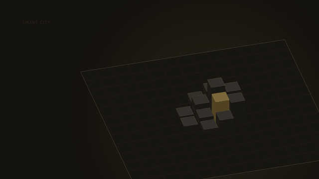

# SlideCraft

HTML 页面展示方式的图鉴：按类别整理 73 种单页展示效果，告诉你「一页可以怎么展示」。每个页面都有对应的 AI 提示词，见 [PROMPTS.md](PROMPTS.md)。

纯 HTML、CSS 和 JS，无需构建，浏览器直接打开 [pages/index.html](pages/index.html) 即可浏览全部页面。

## 使用

- 每个页面是独立的小型 HTML：改 `config.js` 换内容，不用改代码。
- 支持 5 套主题（dark、light、paper、neon、terminal）、倍速、暂停和重播。
- 可单独打开，也可以用 `<iframe>` 嵌入演示文稿：

```html
<iframe src="pages/number-counter/index.html?theme=light&speed=1" allow="autoplay"></iframe>
```

嵌入参数、`postMessage` 控制和新增页面的方法见 [pages/README.md](pages/README.md)。想用 AI 做一个同类页面，复制 [PROMPTS.md](PROMPTS.md) 里对应的提示词即可。

## 开场与封面

<table>
<tr><td width="33%" valign="top"><a href="pages/hero-intro/"></a><br><b>开场封面</b><br>粒子、渐变、网格、圆环背景</td><td width="33%" valign="top"><a href="pages/countdown/"></a><br><b>倒计时</b><br>翻页数字，可指定日期</td><td width="33%" valign="top"><a href="pages/kinetic-type/"></a><br><b>动态排版</b><br>预告片式大字：冲击、滑入、回声、拆字</td></tr>
<tr><td width="33%" valign="top"><a href="pages/logo-reveal/"></a><br><b>品牌 Logo 揭示</b><br>描边画出轮廓、填充、高光扫过</td><td width="33%" valign="top"><a href="pages/chapter-title/"></a><br><b>章节转场页</b><br>巨大章节序号滚动，色块或线条背景</td><td width="33%" valign="top"><a href="pages/title-split/"></a><br><b>分屏标题入场</b><br>竖带依次上滑拼成标题</td></tr>
</table>

## 文字与排版

<table>
<tr><td width="33%" valign="top"><a href="pages/text-reveal/"></a><br><b>逐句文案</b><br>打字、遮罩、逐词、Glitch 等切换</td><td width="33%" valign="top"><a href="pages/quote-carousel/"></a><br><b>金句轮播</b><br>逐字显现，进度条，圆点跳转</td><td width="33%" valign="top"><a href="pages/marquee/"></a><br><b>滚动跑马灯</b><br>多行无限滚动的文字与 Logo</td></tr>
<tr><td width="33%" valign="top"><a href="pages/particle-text/"></a><br><b>粒子成字</b><br>粒子聚成文字，鼠标可冲散</td><td width="33%" valign="top"><a href="pages/credits-roll/"></a><br><b>片尾滚动字幕</b><br>片尾滚动字幕</td><td width="33%" valign="top"><a href="pages/danmaku/"></a><br><b>弹幕墙</b><br>多轨道弹幕飞过</td></tr>
<tr><td width="33%" valign="top"><a href="pages/word-cloud/"></a><br><b>词云</b><br>按权重螺旋摆放的词云</td><td width="33%" valign="top"><a href="pages/matrix-rain/"></a><br><b>字符雨</b><br>字符雨背景加标题</td><td width="33%"></td></tr>
</table>

## 数据可视化

<table>
<tr><td width="33%" valign="top"><a href="pages/number-counter/"></a><br><b>数字滚动</b><br>大数字依次滚动到目标值</td><td width="33%" valign="top"><a href="pages/chart-animated/"></a><br><b>动态图表</b><br>柱状图、折线图、环形图生长动画</td><td width="33%" valign="top"><a href="pages/bar-race/"></a><br><b>排行榜赛跑</b><br>条形随时间重排</td></tr>
<tr><td width="33%" valign="top"><a href="pages/radar-chart/"></a><br><b>雷达图</b><br>多系列多边形生长，悬停高亮、点击开关</td><td width="33%" valign="top"><a href="pages/funnel-chart/"></a><br><b>漏斗图</b><br>阶段转化率，梯形依次展开</td><td width="33%" valign="top"><a href="pages/gantt-schedule/"></a><br><b>甘特图</b><br>条形生长，进度填充，今日线扫过</td></tr>
<tr><td width="33%" valign="top"><a href="pages/gauge-dashboard/"></a><br><b>仪表盘</b><br>指针或弧线仪表，分区着色</td><td width="33%" valign="top"><a href="pages/progress-rings/"></a><br><b>进度环组</b><br>嵌套进度环</td><td width="33%" valign="top"><a href="pages/heatmap-calendar/"></a><br><b>热力日历</b><br>贡献图式热力日历</td></tr>
<tr><td width="33%" valign="top"><a href="pages/sankey-flow/"></a><br><b>桑基图</b><br>桑基图，流量带依次展开</td><td width="33%" valign="top"><a href="pages/treemap/"></a><br><b>矩形树图</b><br>矩形树图，面积表示数值</td><td width="33%" valign="top"><a href="pages/stock-ticker/"></a><br><b>行情滚动条</b><br>行情滚动条加实时折线</td></tr>
</table>

## 流程与结构

<table>
<tr><td width="33%" valign="top"><a href="pages/timeline/"></a><br><b>时间线</b><br>事件依次点亮，可点击跳转</td><td width="33%" valign="top"><a href="pages/flow-diagram/"></a><br><b>流程 / 架构图</b><br>节点出现，数据光点沿连线流动</td><td width="33%" valign="top"><a href="pages/step-tour/"></a><br><b>步骤导览</b><br>聚光灯依次高亮界面区域</td></tr>
<tr><td width="33%" valign="top"><a href="pages/orbit-map/"></a><br><b>轨道式生态图</b><br>同心轨道旋转，悬停查看说明</td><td width="33%" valign="top"><a href="pages/org-chart/"></a><br><b>组织架构树</b><br>组织架构树，可折叠展开</td><td width="33%" valign="top"><a href="pages/mind-map/"></a><br><b>思维导图</b><br>思维导图，分支逐层生长</td></tr>
<tr><td width="33%" valign="top"><a href="pages/roadmap/"></a><br><b>产品路线图</b><br>季度路线图，状态与进度</td><td width="33%" valign="top"><a href="pages/swimlane/"></a><br><b>泳道流程图</b><br>跨角色泳道流程图</td><td width="33%" valign="top"><a href="pages/decision-tree/"></a><br><b>决策树</b><br>决策树，沿选择路径高亮</td></tr>
<tr><td width="33%" valign="top"><a href="pages/swot-matrix/"></a><br><b>四象限矩阵</b><br>SWOT 四象限与散点</td><td width="33%" valign="top"><a href="pages/layer-stack/"></a><br><b>分层架构图</b><br>分层架构图，点击放大一层</td><td width="33%"></td></tr>
</table>

## 媒体与图片

<table>
<tr><td width="33%" valign="top"><a href="pages/gallery/"></a><br><b>图片展示墙</b><br>16 张图错落入场，悬停倾斜，点击放大</td><td width="33%" valign="top"><a href="pages/media-wall/"></a><br><b>媒体墙（可配置）</b><br>图片、动图、视频网格，灯箱浏览</td><td width="33%" valign="top"><a href="pages/compare-slider/"></a><br><b>前后对比滑块</b><br>拖动分隔线对比两张图，自动扫动</td></tr>
<tr><td width="33%" valign="top"><a href="pages/carousel-3d/"></a><br><b>3D 图片轮播</b><br>封面流与环形两种样式，拖动、方向键切换</td><td width="33%" valign="top"><a href="pages/polaroid-scatter/"></a><br><b>拍立得散落</b><br>拍立得散落桌面</td><td width="33%" valign="top"><a href="pages/parallax-layers/"></a><br><b>视差分层</b><br>鼠标驱动的视差分层</td></tr>
<tr><td width="33%" valign="top"><a href="pages/flip-cards/"></a><br><b>翻转卡片</b><br>3D 翻转卡片</td><td width="33%" valign="top"><a href="pages/zoom-lens/"></a><br><b>放大镜细节</b><br>放大镜巡游细节</td><td width="33%" valign="top"><a href="pages/video-frame/"></a><br><b>设备相框视频</b><br>笔记本、手机、电视外框加标注线</td></tr>
</table>

## 产品与界面演示

<table>
<tr><td width="33%" valign="top"><a href="pages/chat-sim/"></a><br><b>Claude Code 对话模拟</b><br>逐字输出、工具调用、diff 代码块</td><td width="33%" valign="top"><a href="pages/terminal-demo/"></a><br><b>终端演示</b><br>敲命令、输出日志、进度条</td><td width="33%" valign="top"><a href="pages/browser-demo/"></a><br><b>浏览器 / 手机演示</b><br>截图轮播加模拟光标点击</td></tr>
<tr><td width="33%" valign="top"><a href="pages/code-showcase/"></a><br><b>代码演示</b><br>语法高亮，逐步 diff，聚焦区域</td><td width="33%" valign="top"><a href="pages/phone-scroll/"></a><br><b>手机长图滚动</b><br>手机里滚动长截图，停靠批注</td><td width="33%" valign="top"><a href="pages/notification-stack/"></a><br><b>通知堆叠</b><br>系统通知依次弹出堆叠</td></tr>
<tr><td width="33%" valign="top"><a href="pages/command-palette/"></a><br><b>命令面板</b><br>命令面板输入、过滤、执行</td><td width="33%" valign="top"><a href="pages/chat-bubbles/"></a><br><b>聊天气泡</b><br>聊天气泡，输入中动画</td><td width="33%" valign="top"><a href="pages/api-playground/"></a><br><b>接口调试</b><br>接口调试：请求与响应</td></tr>
<tr><td width="33%" valign="top"><a href="pages/live-dashboard/"></a><br><b>实时监控面板</b><br>实时监控面板，异常告警</td><td width="33%" valign="top"><a href="pages/form-wizard/"></a><br><b>表单向导</b><br>多步表单自动填写</td><td width="33%"></td></tr>
</table>

## 信息版式

<table>
<tr><td width="33%" valign="top"><a href="pages/bento-grid/"></a><br><b>便当盒仪表盘</b><br>数字、文字、图片、迷你折线混排的磁贴</td><td width="33%" valign="top"><a href="pages/team-cards/"></a><br><b>团队介绍</b><br>头像卡片聚光灯轮流展开</td><td width="33%" valign="top"><a href="pages/pricing-plans/"></a><br><b>价格方案</b><br>高亮方案渐变边框，月付年付切换</td></tr>
<tr><td width="33%" valign="top"><a href="pages/faq-accordion/"></a><br><b>问答折叠</b><br>问答手风琴</td><td width="33%" valign="top"><a href="pages/feature-table/"></a><br><b>功能对比表</b><br>功能对比表，推荐列高亮</td><td width="33%" valign="top"><a href="pages/checklist-progress/"></a><br><b>清单进度</b><br>清单逐项勾选，总进度增长</td></tr>
<tr><td width="33%" valign="top"><a href="pages/testimonial-wall/"></a><br><b>评价墙</b><br>评价墙，多列反向滚动</td><td width="33%" valign="top"><a href="pages/stat-compare/"></a><br><b>数字对比</b><br>左右大数字对比与差值</td><td width="33%" valign="top"><a href="pages/agenda-list/"></a><br><b>议程目录</b><br>议程目录，当前项高亮</td></tr>
</table>

## 3D 与氛围

<table>
<tr><td width="33%" valign="top"><a href="pages/globe-arcs/"></a><br><b>旋转地球飞线</b><br>点阵地球、城市涟漪、大圆弧线，可拖动</td><td width="33%" valign="top"><a href="pages/tag-sphere/"></a><br><b>3D 标签球</b><br>3D 标签球</td><td width="33%" valign="top"><a href="pages/aurora-bg/"></a><br><b>极光背景</b><br>极光流动渐变背景</td></tr>
<tr><td width="33%" valign="top"><a href="pages/cube-rotate/"></a><br><b>立方体翻面</b><br>3D 立方体翻面</td><td width="33%" valign="top"><a href="pages/ripple-grid/"></a><br><b>波纹点阵</b><br>点阵波纹</td><td width="33%" valign="top"><a href="pages/terrain-lines/"></a><br><b>山脉线条</b><br>线条山脉</td></tr>
<tr><td width="33%" valign="top"><a href="pages/isometric-city/"></a><br><b>等距城市</b><br>等距方块城市升起</td><td width="33%"></td><td width="33%"></td></tr>
</table>

## 工具

[scripts/make-previews.py](scripts/make-previews.py) 用 Playwright 录制页面动图到 `previews/`，依赖 Playwright 与 Pillow。
