# SlideCraft

HTML 幻灯片素材库：28 个单页特效和 34 套完整 PPT 模板。纯 HTML、CSS 和 JS，无需构建，浏览器直接打开。

| 目录 | 内容 |
|---|---|
| [pages/](pages/) | 28 个单页特效，由 `config.js` 驱动，可嵌入 PPT |
| [templates/](templates/) | 34 套风格各异的完整 PPT 模板 |

## 单页特效

每个页面是独立的小型 HTML：改 `config.js` 换内容，无需改代码；支持 5 套主题、倍速、暂停和重播；可单独打开，也可以用 `<iframe>` 嵌入。

打开 [pages/index.html](pages/index.html) 浏览全部页面。嵌入参数、`postMessage` 控制和新增页面的方法见 [pages/README.md](pages/README.md)。

```html
<iframe src="pages/number-counter/index.html?theme=light&speed=1" allow="autoplay"></iframe>
```

### 展示

<table>
<tr><td width="33%" valign="top"><a href="pages/gallery/"></a><br><b>图片展示墙</b><br>错落入场、悬停倾斜、点击放大</td><td width="33%" valign="top"><a href="pages/media-wall/"></a><br><b>媒体墙</b><br>图片、动图、视频网格与灯箱</td><td width="33%" valign="top"><a href="pages/compare-slider/"></a><br><b>前后对比滑块</b><br>拖动分隔线对比两张图</td></tr>
<tr><td width="33%" valign="top"><a href="pages/browser-demo/"></a><br><b>浏览器 / 手机演示</b><br>截图轮播，光标模拟点击</td><td width="33%" valign="top"><a href="pages/carousel-3d/"></a><br><b>3D 图片轮播</b><br>封面流与环形两种样式</td><td width="33%" valign="top"><a href="pages/bento-grid/"></a><br><b>便当盒仪表盘</b><br>数字、文字、图片混排磁贴</td></tr>
</table>

### 对话与终端

<table>
<tr><td width="33%" valign="top"><a href="pages/chat-sim/"></a><br><b>Claude Code 对话模拟</b><br>逐字输出、工具调用、diff</td><td width="33%" valign="top"><a href="pages/terminal-demo/"></a><br><b>终端演示</b><br>敲命令、输出日志、进度条</td><td width="33%"></td></tr>
</table>

### 数据

<table>
<tr><td width="33%" valign="top"><a href="pages/number-counter/"></a><br><b>数字滚动</b><br>大数字滚动到目标值</td><td width="33%" valign="top"><a href="pages/chart-animated/"></a><br><b>动态图表</b><br>柱状、折线、环形图生长</td><td width="33%" valign="top"><a href="pages/bar-race/"></a><br><b>排行榜赛跑</b><br>条形随时间重新排序</td></tr>
<tr><td width="33%" valign="top"><a href="pages/radar-chart/"></a><br><b>雷达图</b><br>多系列生长，悬停高亮</td><td width="33%" valign="top"><a href="pages/funnel-chart/"></a><br><b>漏斗图</b><br>阶段转化率逐层展开</td><td width="33%" valign="top"><a href="pages/gantt-schedule/"></a><br><b>甘特图</b><br>条形生长，今日线扫过</td></tr>
</table>

### 叙事

<table>
<tr><td width="33%" valign="top"><a href="pages/timeline/"></a><br><b>时间线</b><br>事件依次点亮，可点击跳转</td><td width="33%" valign="top"><a href="pages/flow-diagram/"></a><br><b>流程 / 架构图</b><br>节点出现，光点沿连线流动</td><td width="33%" valign="top"><a href="pages/step-tour/"></a><br><b>步骤导览</b><br>聚光灯依次高亮界面区域</td></tr>
<tr><td width="33%" valign="top"><a href="pages/text-reveal/"></a><br><b>逐句文案</b><br>打字、遮罩、逐词、Glitch</td><td width="33%" valign="top"><a href="pages/kinetic-type/"></a><br><b>动态排版</b><br>预告片式冲击、滑入、拆字</td><td width="33%" valign="top"><a href="pages/quote-carousel/"></a><br><b>金句轮播</b><br>逐字显现，进度条切换</td></tr>
<tr><td width="33%" valign="top"><a href="pages/code-showcase/"></a><br><b>代码演示</b><br>语法高亮与逐步 diff</td><td width="33%"></td><td width="33%"></td></tr>
</table>

### 氛围

<table>
<tr><td width="33%" valign="top"><a href="pages/hero-intro/"></a><br><b>开场封面</b><br>粒子、渐变、网格、圆环背景</td><td width="33%" valign="top"><a href="pages/marquee/"></a><br><b>滚动跑马灯</b><br>多行无限滚动的文字或图片</td><td width="33%" valign="top"><a href="pages/countdown/"></a><br><b>倒计时</b><br>翻页数字，指定日期或秒数</td></tr>
<tr><td width="33%" valign="top"><a href="pages/globe-arcs/"></a><br><b>旋转地球飞线</b><br>点阵地球与大圆弧线，可拖动</td><td width="33%" valign="top"><a href="pages/orbit-map/"></a><br><b>轨道式生态图</b><br>同心轨道旋转，悬停看说明</td><td width="33%" valign="top"><a href="pages/team-cards/"></a><br><b>团队介绍</b><br>头像卡片聚光灯轮流展开</td></tr>
<tr><td width="33%" valign="top"><a href="pages/pricing-plans/"></a><br><b>价格方案</b><br>高亮方案、月付年付切换</td><td width="33%"></td><td width="33%"></td></tr>
</table>

## PPT 模板

34 套完整模板，来自 [beautiful-html-templates](https://github.com/zarazhangrui/beautiful-html-templates)（MIT），原样收录。

在 [templates/index.json](templates/index.json) 中按场合（`occasion`）和气质（`mood`）挑选，打开 `templates/<名称>/template.html` 预览，方向键翻页。每套模板含 `template.html`、`template.json`（元数据）和 `design.md`（配色、字体与使用规则）。

<table>
<tr><td width="33%" valign="top"><a href="templates/8-bit-orbit/template.html">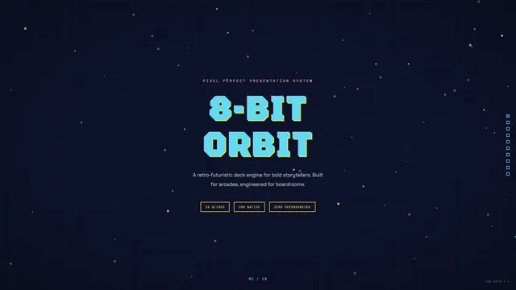</a><br><b>8-Bit Orbit</b>（dark）<br>像素街机，霓虹配深蓝</td><td width="33%" valign="top"><a href="templates/biennale-yellow/template.html">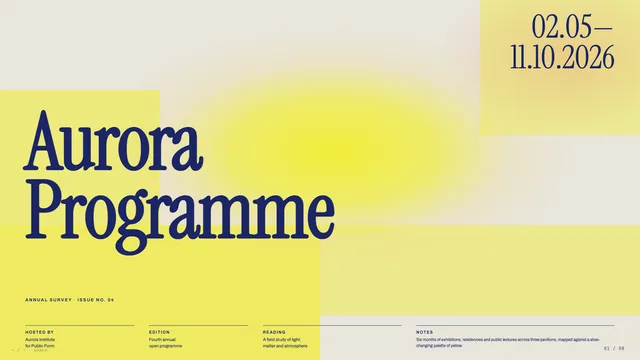</a><br><b>Biennale Yellow</b>（light）<br>羊皮纸上的日光黄与靛蓝衬线</td><td width="33%" valign="top"><a href="templates/block-frame/template.html">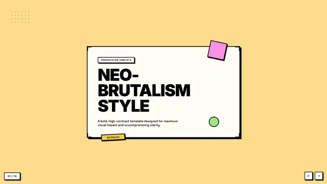</a><br><b>BlockFrame</b>（light）<br>新粗野主义，粉彩色块配粗黑边</td></tr>
<tr><td width="33%" valign="top"><a href="templates/blue-professional/template.html">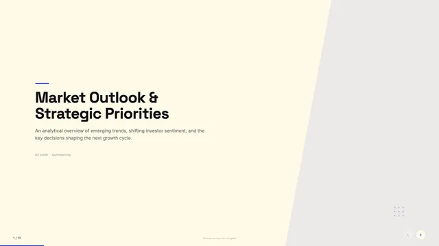</a><br><b>Blue Professional</b>（light）<br>奶油纸配钴蓝，现代商务</td><td width="33%" valign="top"><a href="templates/bold-poster/template.html">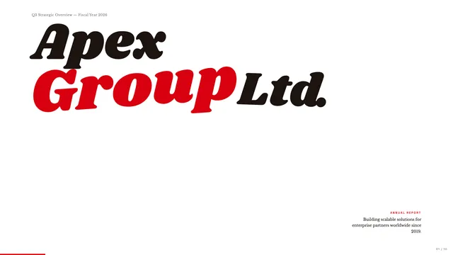</a><br><b>Bold Poster</b>（light）<br>超大展示字加消防车红</td><td width="33%" valign="top"><a href="templates/broadside/template.html">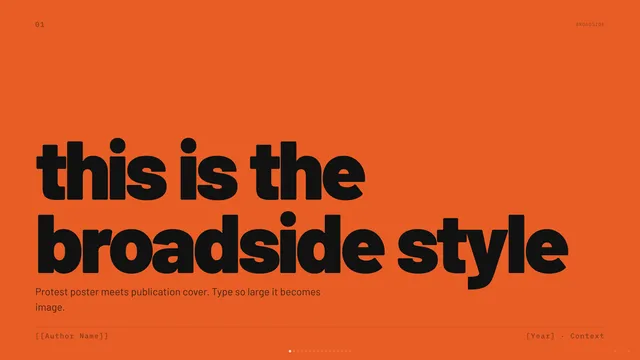</a><br><b>Broadside</b>（dark）<br>深色编辑风，火橙点缀，中英双语字体</td></tr>
<tr><td width="33%" valign="top"><a href="templates/capsule/template.html">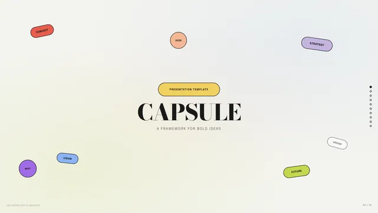</a><br><b>Capsule</b>（light）<br>药丸形卡片，暖白底配糖果色</td><td width="33%" valign="top"><a href="templates/cartesian/template.html">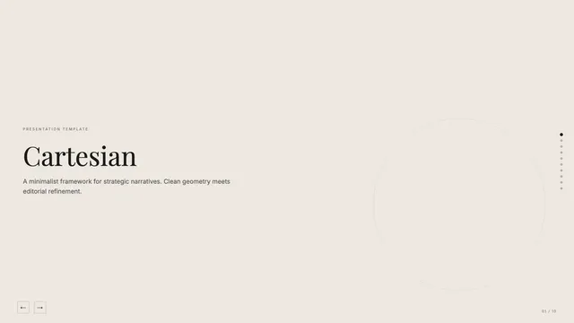</a><br><b>Cartesian</b>（light）<br>暖中性色配 Playfair 衬线，从容克制</td><td width="33%" valign="top"><a href="templates/cobalt-grid/template.html">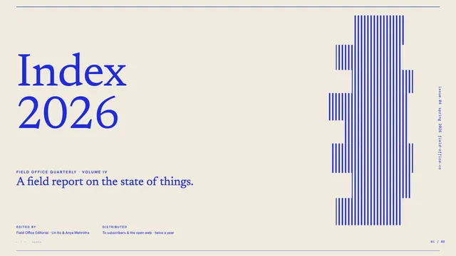</a><br><b>Cobalt Grid</b>（light）<br>方格纸上的钴蓝衬线</td></tr>
<tr><td width="33%" valign="top"><a href="templates/coral/template.html">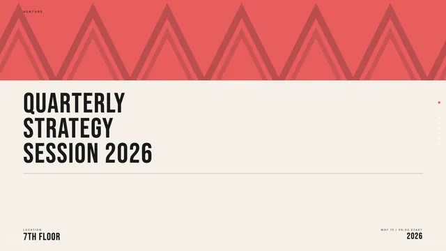</a><br><b>Coral</b>（mixed）<br>近黑底，奶油与珊瑚色，超大 Bebas Neue</td><td width="33%" valign="top"><a href="templates/creative-mode/template.html">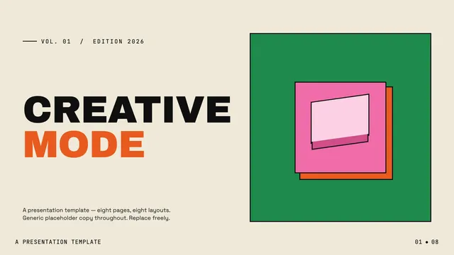</a><br><b>Creative Mode</b>（light）<br>奶油纸配绿粉橙黄多色强调</td><td width="33%" valign="top"><a href="templates/daisy-days/template.html">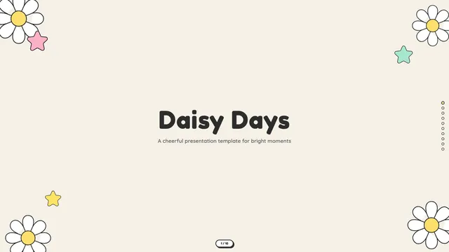</a><br><b>Daisy Days</b>（light）<br>手绘雏菊、星星、彩虹，柔和友好</td></tr>
<tr><td width="33%" valign="top"><a href="templates/editorial-forest/template.html">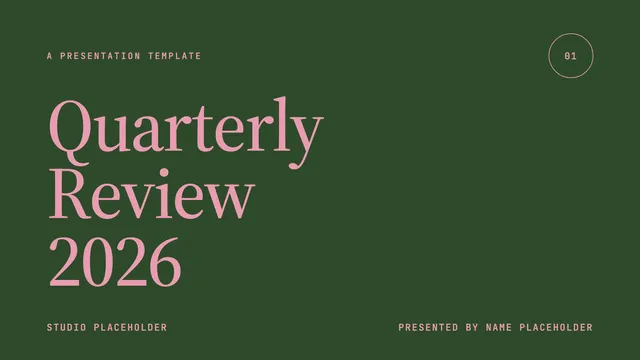</a><br><b>Editorial Forest</b>（mixed）<br>森林绿、灰粉、暖奶油，季度复盘气质</td><td width="33%" valign="top"><a href="templates/editorial-tri-tone/template.html">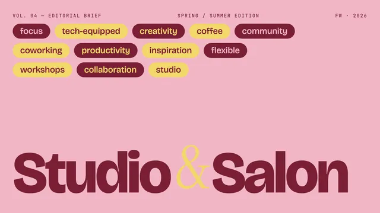</a><br><b>Editorial Tri-Tone</b>（mixed）<br>灰粉、芥末奶油、深酒红三色编辑系统</td><td width="33%" valign="top"><a href="templates/emerald-editorial/template.html">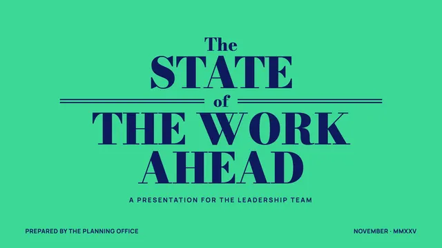</a><br><b>Emerald Editorial</b>（mixed）<br>翡翠绿、海军蓝、纸色，杂志封面式商务</td></tr>
<tr><td width="33%" valign="top"><a href="templates/grove/template.html">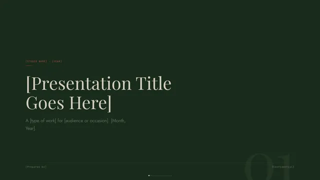</a><br><b>Grove</b>（mixed）<br>森林绿底配奶油字，一点锈红</td><td width="33%" valign="top"><a href="templates/long-table/template.html">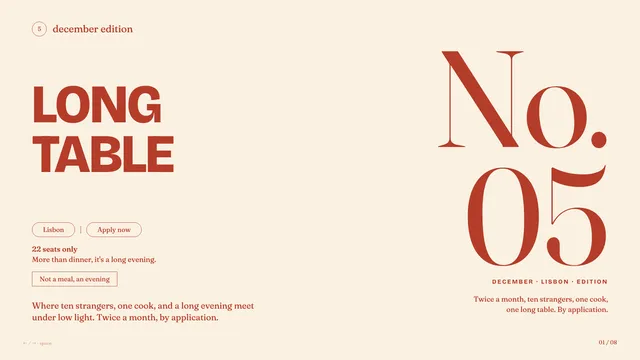</a><br><b>Long Table</b>（light）<br>暖奶油与锈红，餐会俱乐部气质</td><td width="33%" valign="top"><a href="templates/mat/template.html">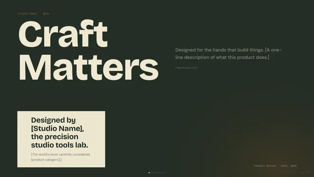</a><br><b>Mat</b>（mixed）<br>深鼠尾草绿、骨白、焦橙，20 世纪中期现代主义</td></tr>
<tr><td width="33%" valign="top"><a href="templates/monochrome/template.html">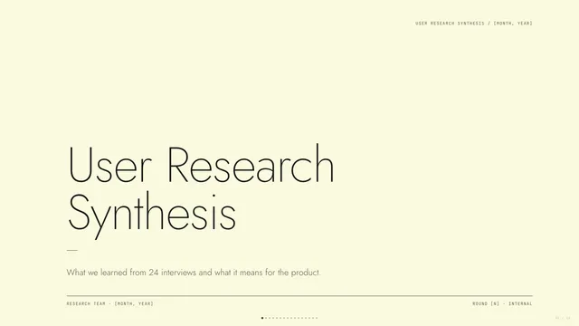</a><br><b>Monochrome</b>（light）<br>象牙账本纸配纯黑字，没有任何颜色</td><td width="33%" valign="top"><a href="templates/neo-grid-bold/template.html">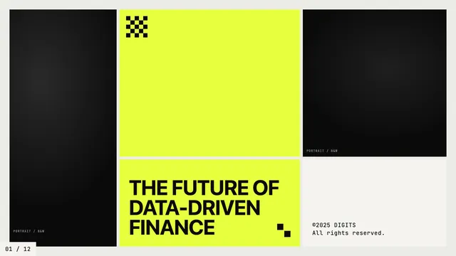</a><br><b>Neo-Grid Bold</b>（light）<br>编辑式新粗野，只有一种荧光黄</td><td width="33%" valign="top"><a href="templates/peoples-platform/template.html">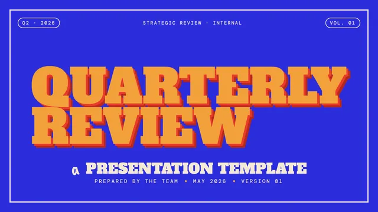</a><br><b>People's Platform (Block & Bold)</b>（light）<br>活动海报感，蓝橙红配手写字</td></tr>
<tr><td width="33%" valign="top"><a href="templates/pin-and-paper/template.html">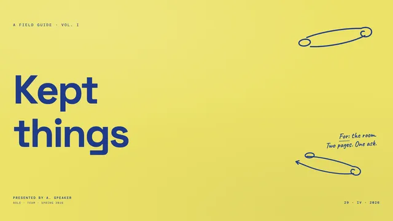</a><br><b>Pin & Paper</b>（light）<br>黄纸、安全别针插画、蓝墨手写</td><td width="33%" valign="top"><a href="templates/pink-script/template.html">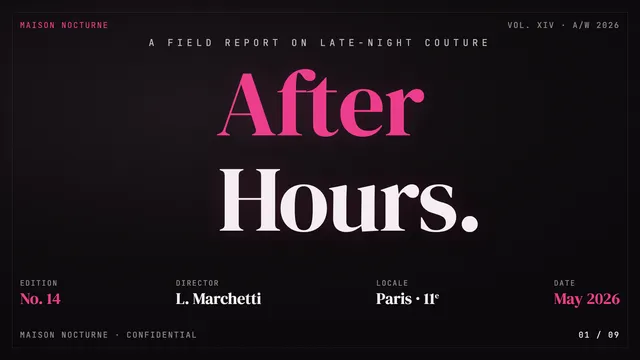</a><br><b>Pink Script — After Hours</b>（dark）<br>黑底配亮粉，深夜杂志的奢华感</td><td width="33%" valign="top"><a href="templates/playful/template.html">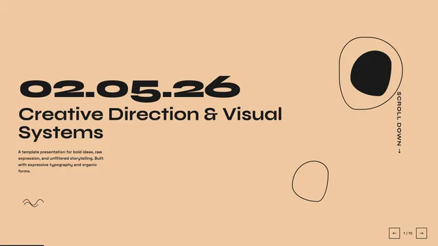</a><br><b>Playful</b>（light）<br>暖桃色底配 Syne 字体，独立产品发布</td></tr>
<tr><td width="33%" valign="top"><a href="templates/raw-grid/template.html">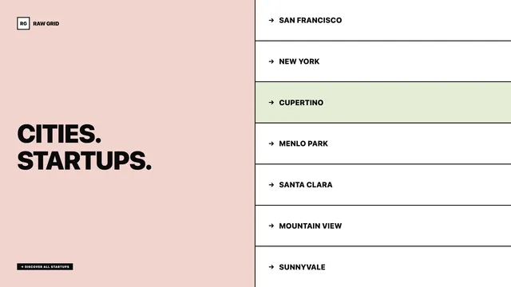</a><br><b>Raw Grid</b>（light）<br>新粗野，粗边框、偏移阴影</td><td width="33%" valign="top"><a href="templates/retro-windows/template.html">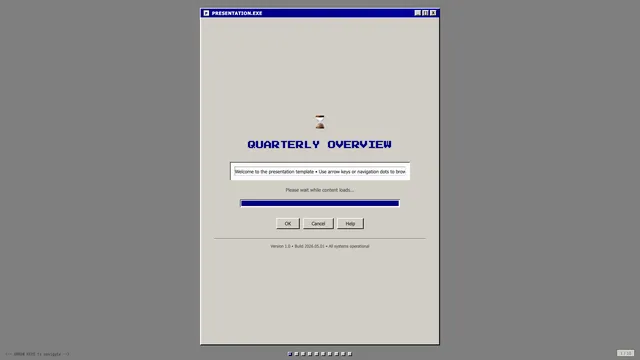</a><br><b>Retro Windows</b>（light）<br>Windows 95 窗口风格</td><td width="33%" valign="top"><a href="templates/retro-zine/template.html">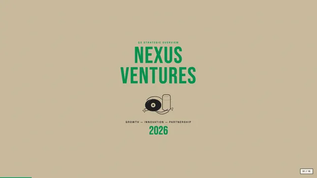</a><br><b>Retro Zine</b>（light）<br>米色纸配绿色，孔版印刷杂志</td></tr>
<tr><td width="33%" valign="top"><a href="templates/sakura-chroma/template.html">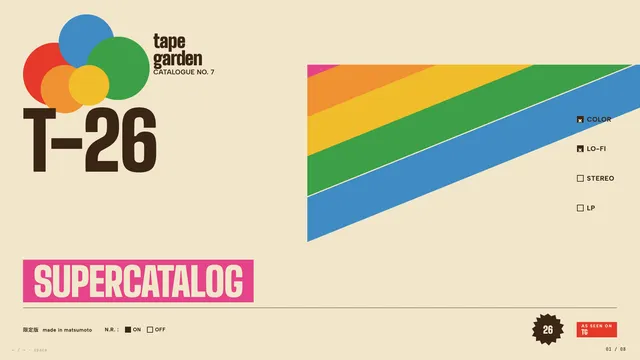</a><br><b>Sakura Chroma</b>（light）<br>日式老磁带包装，斜向彩虹条</td><td width="33%" valign="top"><a href="templates/scatterbrain/template.html">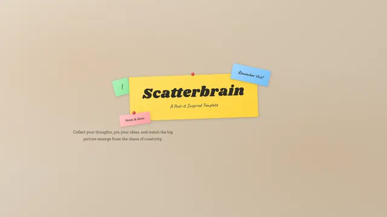</a><br><b>Scatterbrain</b>（light）<br>便利贴风格，粉彩纸条配手写</td><td width="33%" valign="top"><a href="templates/signal/template.html">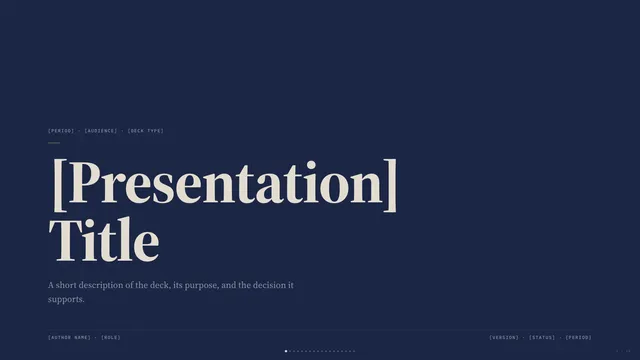</a><br><b>Signal</b>（mixed）<br>深海军蓝、骨白纸、一抹哑金</td></tr>
<tr><td width="33%" valign="top"><a href="templates/soft-editorial/template.html">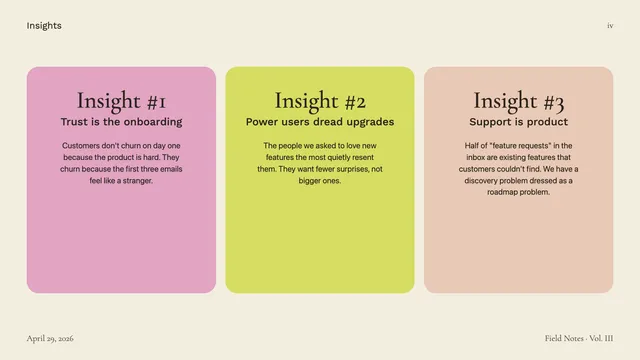</a><br><b>Soft Editorial</b>（light）<br>Cormorant 衬线，暖纸配鼠尾草绿与腮红粉</td><td width="33%" valign="top"><a href="templates/stencil-tablet/template.html">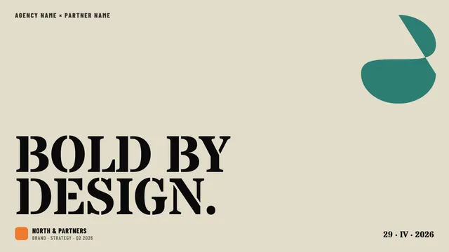</a><br><b>Stencil & Tablet</b>（light）<br>骨白纸、镂空标题、六色大地色板</td><td width="33%" valign="top"><a href="templates/studio/template.html">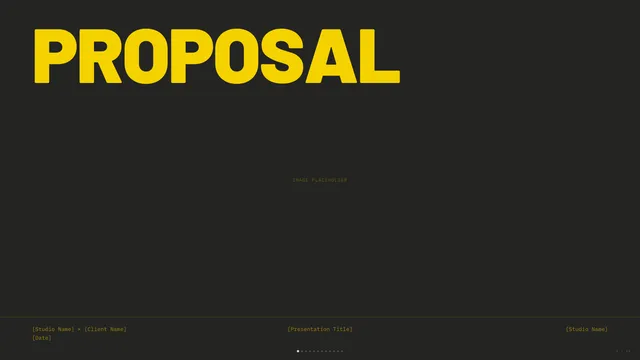</a><br><b>Studio</b>（dark）<br>黑底电光黄，高压设计工作室</td></tr>
<tr><td width="33%" valign="top"><a href="templates/vellum/template.html">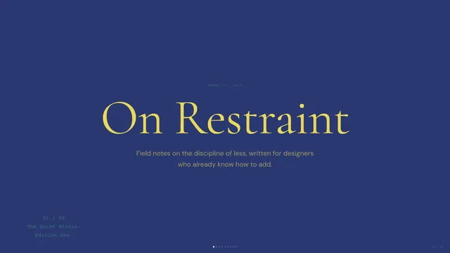</a><br><b>Vellum</b>（dark）<br>深蓝配暖黄衬线，安静的学术气质</td><td width="33%"></td><td width="33%"></td></tr>
</table>

## 工具

- [scripts/make-previews.py](scripts/make-previews.py)：生成 `previews/` 下的动图和截图，依赖 Playwright 与 Pillow。
- [scripts/check.mjs](scripts/check.mjs)：检查模板每页是否超出 1920×1080，依赖 `google-chrome`。

## 许可

`templates/` 遵循上游的 MIT 协议，见 [templates/LICENSE](templates/LICENSE)。
