# SlideCraft

HTML 页面展示方式的图鉴：按类别整理各种单页展示效果，告诉你「一页可以怎么展示」。已实现 28 个，收录 45 个待做想法。每个页面都有对应的 AI 提示词，见 [PROMPTS.md](PROMPTS.md)。

纯 HTML、CSS 和 JS，无需构建，浏览器直接打开 [pages/index.html](pages/index.html) 即可浏览全部页面。

## 使用

- 每个页面是独立的小型 HTML：改 `config.js` 换内容，不用改代码。
- 支持 5 套主题（dark、light、paper、neon、terminal）、倍速、暂停和重播。
- 可单独打开，也可以用 `<iframe>` 嵌入演示文稿：

```html
<iframe src="pages/number-counter/index.html?theme=light&speed=1" allow="autoplay"></iframe>
```

嵌入参数、`postMessage` 控制和新增页面的方法见 [pages/README.md](pages/README.md)。想用 AI 做一个同类页面，复制 [PROMPTS.md](PROMPTS.md) 里对应的提示词即可。

## 开场与封面

<table>
<tr><td width="33%" valign="top"><a href="pages/hero-intro/">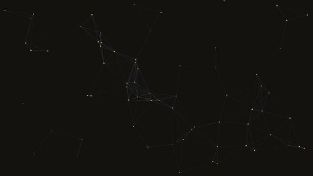</a><br><b>开场封面</b><br>粒子、渐变、网格、圆环背景</td><td width="33%" valign="top"><a href="pages/countdown/"></a><br><b>倒计时</b><br>翻页数字，可指定日期</td><td width="33%" valign="top"><a href="pages/kinetic-type/"></a><br><b>动态排版</b><br>预告片式大字：冲击、滑入、回声、拆字</td></tr>
</table>

待做：品牌 Logo 揭示、章节转场页、分屏标题入场。

## 文字与排版

<table>
<tr><td width="33%" valign="top"><a href="pages/text-reveal/"></a><br><b>逐句文案</b><br>打字、遮罩、逐词、Glitch 等切换</td><td width="33%" valign="top"><a href="pages/quote-carousel/"></a><br><b>金句轮播</b><br>逐字显现，进度条，圆点跳转</td><td width="33%" valign="top"><a href="pages/marquee/">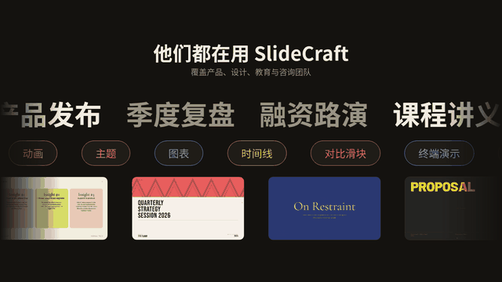</a><br><b>滚动跑马灯</b><br>多行无限滚动的文字与 Logo</td></tr>
</table>

待做：粒子成字、片尾滚动字幕、弹幕墙、词云、字符雨。

## 数据可视化

<table>
<tr><td width="33%" valign="top"><a href="pages/number-counter/"></a><br><b>数字滚动</b><br>大数字依次滚动到目标值</td><td width="33%" valign="top"><a href="pages/chart-animated/">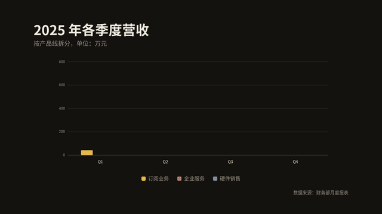</a><br><b>动态图表</b><br>柱状图、折线图、环形图生长动画</td><td width="33%" valign="top"><a href="pages/bar-race/"></a><br><b>排行榜赛跑</b><br>条形随时间重排</td></tr>
<tr><td width="33%" valign="top"><a href="pages/radar-chart/"></a><br><b>雷达图</b><br>多系列多边形生长，悬停高亮、点击开关</td><td width="33%" valign="top"><a href="pages/funnel-chart/"></a><br><b>漏斗图</b><br>阶段转化率，梯形依次展开</td><td width="33%" valign="top"><a href="pages/gantt-schedule/">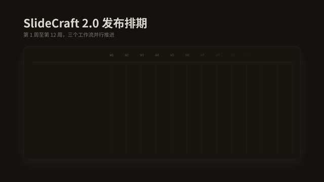</a><br><b>甘特图</b><br>条形生长，进度填充，今日线扫过</td></tr>
</table>

待做：仪表盘、进度环组、热力日历、桑基图、矩形树图、行情滚动条。

## 流程与结构

<table>
<tr><td width="33%" valign="top"><a href="pages/timeline/"></a><br><b>时间线</b><br>事件依次点亮，可点击跳转</td><td width="33%" valign="top"><a href="pages/flow-diagram/"></a><br><b>流程 / 架构图</b><br>节点出现，数据光点沿连线流动</td><td width="33%" valign="top"><a href="pages/step-tour/">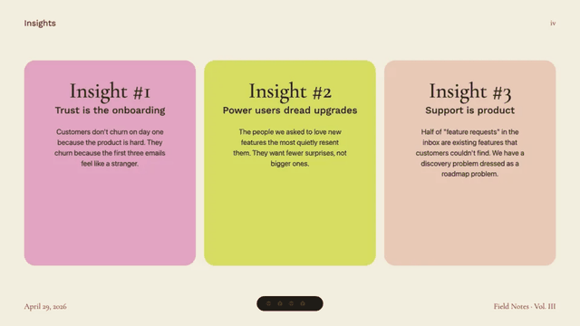</a><br><b>步骤导览</b><br>聚光灯依次高亮界面区域</td></tr>
<tr><td width="33%" valign="top"><a href="pages/orbit-map/">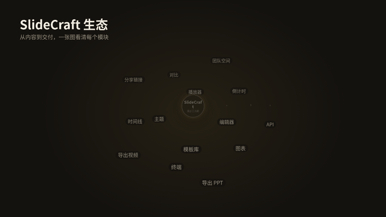</a><br><b>轨道式生态图</b><br>同心轨道旋转，悬停查看说明</td><td width="33%"></td><td width="33%"></td></tr>
</table>

待做：组织架构树、思维导图、产品路线图、泳道流程图、决策树、四象限矩阵、分层架构图。

## 媒体与图片

<table>
<tr><td width="33%" valign="top"><a href="pages/gallery/"></a><br><b>图片展示墙</b><br>16 张图错落入场，悬停倾斜，点击放大</td><td width="33%" valign="top"><a href="pages/media-wall/"></a><br><b>媒体墙（可配置）</b><br>图片、动图、视频网格，灯箱浏览</td><td width="33%" valign="top"><a href="pages/compare-slider/"></a><br><b>前后对比滑块</b><br>拖动分隔线对比两张图，自动扫动</td></tr>
<tr><td width="33%" valign="top"><a href="pages/carousel-3d/">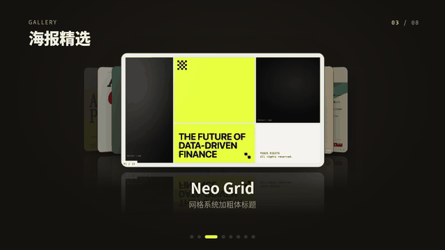</a><br><b>3D 图片轮播</b><br>封面流与环形两种样式，拖动、方向键切换</td><td width="33%"></td><td width="33%"></td></tr>
</table>

待做：拍立得散落、视差分层、翻转卡片、放大镜细节、设备相框视频。

## 产品与界面演示

<table>
<tr><td width="33%" valign="top"><a href="pages/chat-sim/">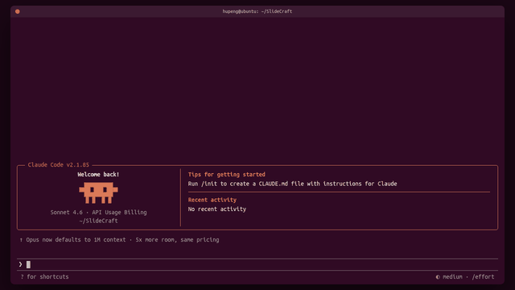</a><br><b>Claude Code 对话模拟</b><br>逐字输出、工具调用、diff 代码块</td><td width="33%" valign="top"><a href="pages/terminal-demo/">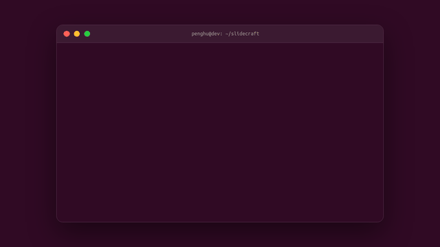</a><br><b>终端演示</b><br>敲命令、输出日志、进度条</td><td width="33%" valign="top"><a href="pages/browser-demo/">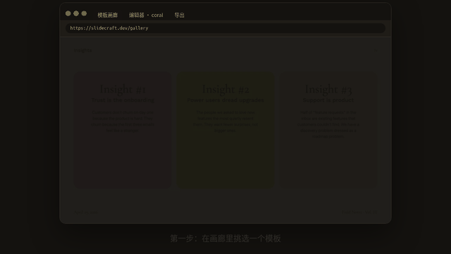</a><br><b>浏览器 / 手机演示</b><br>截图轮播加模拟光标点击</td></tr>
<tr><td width="33%" valign="top"><a href="pages/code-showcase/">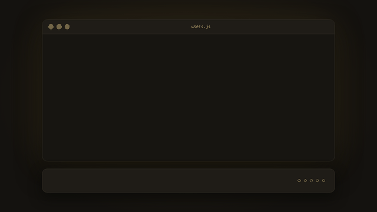</a><br><b>代码演示</b><br>语法高亮，逐步 diff，聚焦区域</td><td width="33%"></td><td width="33%"></td></tr>
</table>

待做：手机长图滚动、通知堆叠、命令面板、聊天气泡、接口调试、实时监控面板、表单向导。

## 信息版式

<table>
<tr><td width="33%" valign="top"><a href="pages/bento-grid/"></a><br><b>便当盒仪表盘</b><br>数字、文字、图片、迷你折线混排的磁贴</td><td width="33%" valign="top"><a href="pages/team-cards/"></a><br><b>团队介绍</b><br>头像卡片聚光灯轮流展开</td><td width="33%" valign="top"><a href="pages/pricing-plans/"></a><br><b>价格方案</b><br>高亮方案渐变边框，月付年付切换</td></tr>
</table>

待做：问答折叠、功能对比表、清单进度、评价墙、数字对比、议程目录。

## 3D 与氛围

<table>
<tr><td width="33%" valign="top"><a href="pages/globe-arcs/"></a><br><b>旋转地球飞线</b><br>点阵地球、城市涟漪、大圆弧线，可拖动</td><td width="33%"></td><td width="33%"></td></tr>
</table>

待做：3D 标签球、极光背景、立方体翻面、波纹点阵、山脉线条、等距城市。

## 工具

[scripts/make-previews.py](scripts/make-previews.py) 用 Playwright 录制页面动图到 `previews/`，依赖 Playwright 与 Pillow。
